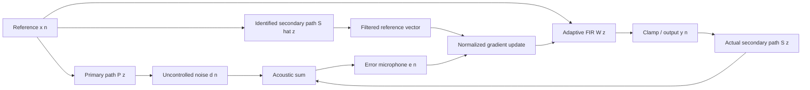

# Universal low-latency active noise control: DSP project report

## Objective and attainable scope

Minimize a measured acoustic error signal using a reference correlated with incoming noise. Deliver identical algorithm semantics across C++, MATLAB and an Android Kotlin port. Demonstrate convergence, frequency-selective attenuation, delay failure, model mismatch and uncorrelated-noise limits. Laptop and phone applications offer simulations and calibrated **bench-fixture** experiments. Ordinary wired and Bluetooth headphones can play demonstration files, but do not automatically become ANC headphones.

## Signal flow

The primary path is the source-to-error-sensor acoustic propagation. The secondary path includes the DAC, driver, acoustic path to the error sensor, ADC, host buffers and delays. A reference microphone should provide advance information; acoustic feedback from the control driver into the reference microphone is neglected in these simulations. A real fixture must minimize or separately model that feedback.

## Discrete-time model and objective

For sample index n, controller length L and column vectors ordered newest first:

    d(n) = sum P(k) x(n-k) + v(n)
    y(n) = w(n)^T xvec(n)
    e(n) = d(n) + sum S(k) y(n-k)
    J = E[e(n)^2]

v(n) is noise uncorrelated with the reference. The controller learns negative cancellation through its coefficients; an additional output inversion would change the sign convention and can cause divergence.

## Filtered-x normalized LMS

    xf(n) = sum Shat(k) x(n-k)
    w(n+1) = (1-leak) w(n)
               - mu * e(n) * xfvec(n) / (epsilon + ||xfvec(n)||^2)

The secondary-path estimate filters the adaptation reference, accounting for the gradient through the output plant. Plain LMS that ignores the secondary path may adapt with the wrong phase. Normalization compensates for reference energy changes; epsilon protects against division by zero; leakage limits coefficient accumulation. The minus sign follows e=d+Sy. This implementation uses mu=0.02 in simulations, leak=1e-6, epsilon=1e-8, L=64. The live C++ default step is 0.03; Windows overrides it to 0.02 to match Android. Live controller length is 256 at 48 kHz. General stability is not guaranteed by these parameter choices; secondary-path error and delay constrain stable adaptation.

Call `output(x[n])` then `adapt(e[n])` exactly once per sample. The simulated plant produces e after output generation. A physical stream receives the residual associated with earlier emitted samples; the measured secondary-path model must contain that delay. Callback frame size and route changes invalidate the model if they change the timing.

## Secondary-path identification

Inject a low-amplitude independent broadband probe with ANC disabled. Record the error sensor, aligned to the software output sample timeline. NLMS identifies an FIR plant using the first 75% of the recording. Freeze coefficients and evaluate normalized mean-square error on the final 25%:

    NMSE_dB = 10 log10( sum (measured-predicted)^2 / sum measured^2 )

Use a plant length long enough to include leading transport delay and the entire relevant impulse response. The calibration tool rejects silent, nonfinite, short or poorly identified recordings (validation NMSE above -15 dB). The MATLAB synthetic identification experiment includes measurement noise and requires NMSE below -30 dB. A good fit to synthetic data is not hardware calibration. `route=simulation` is rejected by the live engine.

## Sampling and filters

- Simulation rate: 8 kHz, Nyquist frequency 4 kHz; primarily low-frequency noise examples. Six seconds per scenario, 48,000 samples. The host stream uses 48 kHz, so an 8 kHz profile cannot be loaded into it.
- FIR convolution: causal tapped-delay line; C++ uses fixed-capacity circular buffers. The educational 63-tap Hamming-windowed sinc low-pass has a 700 Hz cutoff, approximately linear phase and group delay (63-1)/2=31 samples, or 3.875 ms at 8 kHz.
- DC blocker: H(z)=(1-z^-1)/(1-r z^-1), r=exp(-2*pi*10/fs). Its pole is inside the unit circle; the zero at z=1 removes DC. Phase/group delay are frequency dependent.
- Second-order IIR low-pass: RBJ form, Q=1/sqrt(2), cutoff 700 Hz; implemented as transposed direct-form II. Lower order reduces computation but introduces nonlinear phase.
- Sampling experiment: a 5.5 kHz tone aliases to 2.5 kHz at fs=8 kHz. Analog anti-alias filtering must precede the ADC; digital filtering after aliasing cannot recover the original signal.
- Offline multirate example: 48 to 8 kHz decimation by six, preceded by a 127-tap FIR with 3 kHz cutoff. This suppresses a 6 kHz component that would otherwise alias to 2 kHz. Its group delay is 63/48000=1.3125 ms. This is a separate demonstration, not a hidden low-latency conversion stage in the live apps.

The educational FIR, DC blocker and biquad are **not inserted into the adaptive simulation signal path**. Adding them to live input/output requires incorporating their delays and transfer functions into the calibrated model. Front-end operating-system AGC, echo cancellation and noise suppression violate the linear time-invariant plant assumption; bypass where supported and validate experimentally.

## Spectrum, metrics and quantization

Use a one-sided Welch PSD with a 512-sample periodic Hann window, 50% overlap, per-segment mean removal and normalization by fs*sum(window^2). Double non-DC/non-Nyquist bins. Units are FS^2/Hz. FFT bin spacing is 8000/512=15.625 Hz; window leakage means this is not arbitrary-frequency resolving power. Integrate PSD over diagnostic bands 50–150, 150–350, 350–750 and 750–1500 Hz. These are frequency-bin bands, not four independent ANC controllers.

    attenuation_dB = 10 log10( sum baseline^2 / sum residual^2 )

Compute attenuation over the last 25% of each six-second run, using the matched ANC-off noise waveform. The first 0.5 s is reported separately to show startup. Negative attenuation means amplification. A reference microphone RMS divided by an error microphone RMS is not a valid attenuation measurement because their transfer paths differ. WAV outputs preserve equal gain; independently normalizing them would invalidate listening comparisons.

Float DSP avoids repeated PCM rounding. PCM16 export adds quantization; round at the final conversion. For an ideal full-scale sine, the familiar SQNR approximation is 6.02B+1.76 dB. The separate experiment uses a 0.1 FS sine, so the expected SNR is lower by approximately 20 dB. No dither is added; the error can be correlated with a deterministic tone.

## Causality, latency and wireless limitations

A causal feedforward controller needs reference preview at least as large as the total secondary-path delay. In the nominal model primary delay is 24 samples (3 ms) and secondary delay is eight samples (1 ms), leaving 16 samples of preview. It deliberately represents a favorable bench geometry. Increasing secondary delay to 40 or 400 samples exceeds preview; an unpredictable broadband source cannot be predicted from future samples. Narrowband periodic tones can sometimes be predicted, but this does not establish universal broadband ANC.

The 5 ms and 50 ms scenarios are illustrative chosen delays, not measurements or promises for any wired/Bluetooth device. Fixed anti-phase control with unmodeled delay error dt leaves sinusoidal amplitude ratio |1-exp(-j*2*pi*f*dt)|, explaining sensitivity to phase. Transport jitter, separate input/output clocks, packet losses, changing fit and acoustic feedback all worsen real performance.

At 48 kHz, a 128-sample block spans 2.667 ms. Input and output buffers add independently, along with converters, scheduling, acoustic propagation and any codec. Arithmetic runtime alone is not round-trip latency. WASAPI reports a buffer budget estimate; physical latency needs loopback measurement. Android requests low-latency playback but the API request does not prove it was granted or establish ANC feasibility. Headphone-native ANC runs near local microphones/drivers and is the viable wireless architecture.

## Safety and computational cost

Output starts at zero, requires a matching route/rate profile, and is clamped to +/-0.2 FS. Adaptation freezes on clamp activation. Nonfinite values and 16 consecutive near-full-scale raw outputs mute the controller. Devices changing or streams failing stop playback. A normalized amplitude cap is not an acoustic SPL limit; calibration uses a fixture, not a listener's ear. A moving average error-energy growth detector is not implemented, so a physical fixture must additionally monitor SPL and hardware gain.

Per sample, controller output and update cost O(L), secondary-reference convolution O(M), and normalization O(L); memory is O(L+M). C++ arrays are allocated/configured before processing; per-sample processing contains no heap allocation, file IO or locks. Windows polling and Android blocking audio threads are functional research backends, **not certified hard real-time low-latency systems**. Processing cost, deadline misses, drift and actual latency must be measured per route.

## Experiment definitions

P(z): 24 leading zeros then [0.65, 0.15, -0.05]. S(z): eight leading zeros then [0.8, -0.15, 0.05]. Reference broadband is 0.08 FS times deterministic uniform white noise. Hum has 120 and 240 Hz tones plus colored noise. Fan is an AR(1) source, coefficient 0.85. Uncorrelated adds 0.04 FS independent uniform noise at the error sensor. Mismatch changes the estimated first two nonzero secondary taps to [0.65,-0.05]. Path change reduces the true plant gain halfway through while retaining the original estimate. Delay experiments use uncorrelated-in-time white references to expose causality failures. Stronger mismatches, nonstationary feedback and multiple listeners are not validated.

The portable LCG generator uses seed 42, modulus 2^32, multiplier 1664525 and increment 1013904223. C++ and MATLAB consume two draws per sample, including scenarios that do not use the second draw. MATLAB double and C++ float will differ at deep cancellation floors; sample-level comparison tolerance is 1e-4 FS. The Android Kotlin port repeats the three broadband latency cases and is checked independently on the JVM.

## Sources

- MathWorks, [Active Noise Control Using a Filtered-X LMS FIR Adaptive Filter](https://www.mathworks.com/help/audio/ug/active-noise-control-using-a-filtered-x-lms-fir-adaptive-filter.html): physical residual measurement and secondary-path modeling.
- MathWorks, [Active Noise Control with Simulink Real-Time](https://www.mathworks.com/help/audio/ug/active-noise-control-with-simulink.html): filtered-x NLMS adaptation.
- Android, [Audio latency](https://developer.android.com/ndk/guides/audio/audio-latency): device-dependent round-trip latency.
- Android, [AudioRecord](https://developer.android.com/reference/android/media/AudioRecord) and [AudioTrack](https://developer.android.com/reference/android/media/AudioTrack): blocking IO and performance mode APIs.
- Microsoft, [IAudioClient::Initialize](https://learn.microsoft.com/en-us/windows/win32/api/audioclient/nf-audioclient-iaudioclient-initialize): native/shared audio stream behavior.

These sources explain the engineering choices; the executable code uses custom base-MATLAB and C++ implementations rather than licensed DSP System Toolbox objects.

Windows low-period initialization follows [IAudioClient3::InitializeSharedAudioStream](https://learn.microsoft.com/en-us/windows/win32/api/audioclient/nf-audioclient-iaudioclient3-initializesharedaudiostream); the backend requests the minimum reported supported period.

## Experimental stationary-tone controller (version 2.1)

A separate single-error-microphone mode now implements four-phase acoustic calibration, a bounded anti-tone and OFF/ON/OFF measurement. It has been checked against a synthetic delayed acoustic plant in both C++ and Kotlin. `anc_compare_tonal` independently analyzes exported WAVs and compares measured stage powers to a fitted stationary phasor model. It does not require the external reference/error pair used by the FxLMS fixture. See RESEARCH_FEASIBILITY.md for the equations and LIVE_TONAL_DEMO.md for physical setup and limitations. No actual Crystl attenuation has been measured yet.
