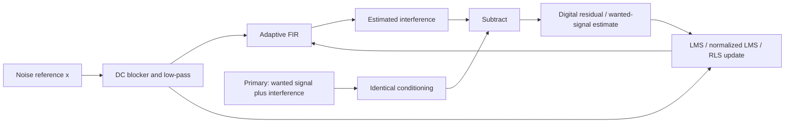

# Full adaptive noise cancellation DSP implementation

This implementation provides two distinct signal paths. **Digital adaptive noise cancellation** estimates interference in a recorded primary signal and subtracts it. **Acoustic active noise control** sends anti-noise through a calibrated physical plant and minimizes an error microphone. The digital residual must not be played and claimed to cancel sound already reaching an ear.

## Reproduce the implementation and results

```powershell
.\scripts\run_full_dsp.ps1
```

This builds the project, runs algorithm/block/fault/allocation tests, executes 15 deterministic algorithm/scenario combinations, and runs an independent MATLAB implementation. No MATLAB toolbox is needed. Results: `results/full_dsp/matlab/REPORT.md`, CSV/MAT data, five PNG/FIG plots and equal-gain clean/noisy/processed WAVs. `processing_us_per_sample` in the C++ table is an instrumented computation measurement including clock-call overhead; it is not device latency or a real-time deadline guarantee.

MATLAB directly: `addpath('matlab'); anc_full_dsp;`. Generate the C++ input traces first with `anc_adaptive --benchmark results/full_dsp/cpp`.

## Implemented signal flow



The reference must correlate with the interfering noise and should not contain the wanted signal. Independent noise cannot be inferred from it. Desired-signal leakage is explicitly demonstrated because successful minimization of total output power can otherwise hide loss of wanted audio. [MathWorks LMS/NLMS noise-cancellation example](https://www.mathworks.com/help/dsp/ug/enhance-a-signal-using-lms-and-normalized-lms-algorithms.html).

## DSP equations

Let xvec(n) contain the latest L conditioned reference samples, d(n) the conditioned primary signal, and w(n) the FIR coefficients:

    vhat(n) = w(n)^T xvec(n)
    e(n) = d(n) - vhat(n)

LMS uses the positive error gradient for this subtraction convention:

    w(n+1) = (1-leak) w(n) + mu e(n) xvec(n)

Normalized LMS divides by input-vector energy:

    w(n+1) = (1-leak) w(n)
               + mu e(n) xvec(n) / (epsilon + xvec(n)^T xvec(n))

The implementation validates positive epsilon and NLMS step below two. This familiar bound does not guarantee stability for every real input or surrounding acoustic loop. LMS requires a step suitable for input power. Coefficients are projected onto an L2 ball, and nonfinite states latch a fault.

RLS minimizes exponentially weighted squared prediction error. With inverse covariance P:

    u = P(n-1) xvec(n)
    denominator = lambda + xvec(n)^T u
    k = u / denominator
    w(n) = w(n-1) + k e(n)
    P(n) = (P(n-1) - u u^T / denominator) / lambda

P starts at 10I in the benchmark (`initialInverseCovariance` in the C++ configuration). Symmetric matrix entries are updated together, with denominator/diagonal/nonfinite checks. With the protective coefficient bound inactive, this is conventional covariance RLS, not a square-root or QR implementation. Projection is a protection mechanism rather than an exact constrained-RLS solver. Numerical robustness for difficult long-duration ill-conditioned inputs remains a limitation. This implementation permits 0.9 < lambda <= 1 and at most 128 RLS taps. LMS-style leakage is deliberately not mixed into the RLS objective. [MathWorks RLS documentation](https://www.mathworks.com/help/dsp/ref/dsp.rlsfilter-system-object.html).

For all algorithms, adaptation can be frozen without discarding the reference history. When reference-vector mean power is below the configured floor, both coefficient adaptation and RLS covariance forgetting pause. Reset clears weights, delay state and covariance without allocation.

## Conditioning and frequency response

The DC blocker has H(z)=(1-z^-1)/(1-r z^-1), r=exp(-2*pi*fc/fs). A transposed-direct-form-II low-pass biquad follows it. Digital cancellation uses separate, identical filter states for reference and primary. Its desired output is therefore the **conditioned** clean signal. Evaluation against an unfiltered clean target would incorrectly count intended filtering as cancellation error.

The benchmark uses fs=8 kHz, fc=10 Hz, low-pass cutoff 1500 Hz, Q=1/sqrt(2), and 16 adaptive taps. Reference sampling, clock alignment and analog anti-alias filtering must be established before the DSP input. The software does not undo ADC aliasing or automatically align independent clocks. Filter group delay and PSD/sampling/quantization demonstrations are also covered by `anc_dsp_visualizer.m` and `anc_fundamentals.m`.

## Acoustic FxNLMS chain

`DspEngine` retains the physical acoustic convention:

    y(n) = w(n)^T rvec(n)
    e(n) = d(n) + S(z) y(n)
    xf(n) = Shat(z) r(n)
    w(n+1) = (1-leak)w(n)
               - mu e(n) xfvec(n)/(epsilon + ||xfvec(n)||^2)

The negative sign is essential because physical anti-noise is added. `r` can be an optionally DC-blocked/low-passed reference. Its conditioning is upstream of both the controller and filtered-reference model. Shat must model the **downstream output-to-error-microphone path**, including relevant IO/acoustic delay. No unmodeled output filter is inserted. The error microphone is not silently low-pass filtered during adaptation. [MathWorks filtered-x ANC example](https://www.mathworks.com/help/audio/ug/active-noise-control-using-a-filtered-x-lms-fir-adaptive-filter.html).

Secondary-path identification uses the existing NLMS calibration tool, a held-out validation window, sufficient taps for transport delay, and route/rate-bound profiles. Simulation profiles cannot arm the live engine. Input-reference conditioning is opt-in for compatibility with existing calibrated setups. The sample and block APIs produce the same sample ordering; `processBlock` adds no extra algorithmic buffering, though actual platform IO buffers still add delay.

Acoustic guards now include:

- Reference-power adaptation gate and caller-controlled freeze.
- Coefficient norm projection and nonfinite-state muting.
- Output clamp at +/-0.2 FS, adaptation freeze on clipping, and a plant-length cooldown after clipping.
- Trip on 100 ms sustained output limiting and existing near-full-scale clipping detection.
- Optional error-growth watchdog: a caller supplies the RMS from a matched ANC-off **error microphone** recording. After a 0.5 s grace period, sustained excess error for 0.2 s trips output. Default baseline zero disables this watchdog; the app must supply a valid baseline to use it. A source level change can also trigger this conservative protection.
- Invalid block pointers or a fault within a block mute the entire output block.

The watchdog is a protection mechanism, not an attenuation estimator. Reference/error RMS ratios are not substituted for matched ANC-off/on measurements. These guards cannot guarantee global acoustic stability, safe SPL or cancellation with arbitrary headphone latency.

## APIs and files

Calibration input must be finite normalized audio with absolute sample values below 0.95 FS; clipped or unnormalized probe/response recordings are rejected. The CLI accepts sample rates from 8 to 192 kHz and requires held-out NMSE strictly below -15 dB. This numerical gate alone does not establish that a recording belongs to the intended physical route.

| Purpose | Implementation |
|---|---|
| LMS/NLMS/RLS FIR, streaming blocks, conditioning | `core/include/anc/adaptive.h` |
| Acoustic normalized filtered-x LMS | `core/include/anc/fxlms.h` |
| Acoustic processing, profile gates, watchdogs, telemetry | `core/include/anc/dsp_engine.h` |
| Secondary-path identification and profiles | `calibration.h`, `secondary_path.h` |
| Android reference-based DSP module | `AdaptiveDsp.kt` |
| Synthetic benchmark and offline CSV processing | `tools/simulator/anc_adaptive.cpp` |
| Independent MATLAB algorithms and plots | `matlab/anc_full_dsp.m` |
| Convergence, block invariance and fault tests | `core/tests/test_adaptive.cpp` |
| Instrumented processing allocation test | `core/tests/test_allocations.cpp` |

Example C++:

```cpp
anc::AdaptiveConfig config;
config.algorithm = anc::AdaptiveAlgorithm::Nlms;
config.taps = 64;
config.step = 0.05f;
anc::ConditioningConfig band;
band.sampleRate = 48000;
band.lowpass = 1500;
anc::AdaptiveNoiseCanceller canceller;
canceller.configure(config, band); // allocation/configuration before audio starts
canceller.processBlock(reference, primary, residual, noiseEstimate, frames);
```

Example Android DSP use:

```kotlin
val dsp = AdaptiveDsp(AdaptiveMethod.NLMS, taps=64, rate=48000, step=0.05)
dsp.processBlock(reference, primary, residual)
```

The Android module implements LMS/NLMS/RLS and conditioning with preallocated numeric arrays. It does not turn a single phone microphone into independent desired/noise channels. The existing app UI continues to use its FxNLMS fixture and single-tone experimental modes; the generic digital algorithms are a library integration surface, not a new universal ANC toggle.

The filter objects and telemetry have a single processing-thread owner. Configuration/reset/weight export and concurrent UI reads are not safe while processing. Hand telemetry to a UI using a separate appropriate snapshot mechanism; `weights()` deliberately returns an allocating copy for use outside the callback.

## Offline data processing

```
anc_adaptive --process input.csv nlms output.csv
```

The command expects synchronized 8 kHz normalized samples with header `reference,primary`. It outputs `estimate,residual`. Rate/conditioning parameters are fixed for this demonstration CLI; use the library configuration for other sample rates. It reports no SNR without a known clean target and does not infer physical acoustic provenance from an input file.

## Experiments and evaluation

Five cases are executed for each of LMS, NLMS and RLS: stationary path, path changing at 2 s, independent added disturbance, wanted-signal leakage into the reference, and a 1 s reference dropout. The desired signal is a synthetic amplitude-modulated two-tone waveform, not a speech recording. The same conditioning is applied to its known clean target. Final-window SNR, improvement, MSE and desired-signal projection gain are reported. Startup, path tracking and dropout traces are plotted separately because a final-window average can hide temporary failure.

One-sided Welch PSD uses 512-sample periodic Hann windows, 50% overlap, per-segment mean removal and density normalization. Units are FS^2/Hz. Base-MATLAB recomputes every adaptive sample from the C++ input traces and asserts a maximum residual disagreement below 2e-4 FS. Comparing implementations this way validates arithmetic; it does not validate the physical microphone/speaker model.

## Real-time cost and limits

LMS/NLMS cost O(L) per sample and use O(L) histories. RLS costs O(L^2) and uses an O(L^2) inverse covariance matrix; long RLS filters may be unsuitable for phone callback deadlines. Matrix storage is allocated only during configuration. The C++ allocation test instruments new/new[] during sample/block processing. Core processing performs no file IO, locks or formatting. This is not a hard-real-time scheduling certification.

Physical headphone cancellation still needs a suitable observable error signal, stable calibrated output path and sufficient preview or predictable noise. The Crystl single-tone experiment and actual recording comparison remain separate. No microphone-point or ear-canal attenuation is fabricated from these synthetic SNR values.
