# Active and Adaptive Noise Cancellation DSP Project Report

Universal ANC Lab version 2.2

Simulation implementation and experimental hardware measurement

29 October 2026

Repository https://github.com/troon07/ANC-DSP

Software baseline ed65e136697664b49c131bc6d04a65bba660bb56

## Abstract

This project implements adaptive digital noise cancellation and acoustic active noise control using custom C++17, Kotlin and base MATLAB code. LMS, normalized LMS and recursive least squares estimate interference in a primary signal from a correlated reference. A separate filtered-x normalized LMS controller accounts for the secondary speaker-to-error-microphone path when producing physical anti-noise. Windows and Android applications provide experimental audio modes, calibration support and recording export.

The numerical evaluation comprises eight acoustic-model experiments and fifteen digital algorithm and scenario combinations. The nominal acoustic model achieves 48.390 dB reduction in MATLAB and 48.210 dB in C++; increasing the modeled secondary delay beyond reference preview removes the broadband benefit. In the stationary digital experiment, SNR improvements are 16.903 dB for LMS, 13.967 dB for NLMS and 23.895 dB for RLS with the selected parameters. These are synthetic numerical results, not measured headset attenuation. The largest residual disagreement in the fifteen-case C++ and MATLAB comparison is approximately 2.24e-5 FS; Kotlin independently agrees to the same order.

A separate stationary-tone experiment uses four phase probes and OFF ON OFF measurement to attempt cancellation at a laptop or phone microphone using an ordinary earbud. This provides a testable route with the available laptop, Android 16 phone and boAt Nirvana Crystl earbuds. No physical phone execution, microphone-point reduction, ear-canal attenuation or actual round-trip latency has been measured. The achieved deliverable is an implemented and tested DSP research system with an experimental hardware measurement workflow; universal low-latency cancellation through arbitrary headphones remains an unachieved research objective.

Keywords adaptive filtering, LMS, NLMS, RLS, filtered-x LMS, active noise control, secondary path, MATLAB, Android, WASAPI.

## Contents

1 Introduction and objectives

2 Background and engineering context

3 System architecture and signal definitions

4 DSP foundations

5 Adaptive digital algorithms

6 Acoustic adaptive control and calibration

7 Software implementation and platform integration

8 Experimental design and evaluation metrics

9 Executed numerical results

10 Physical hardware demonstration and measurement

11 Verification and reproducibility

12 Limitations and future development

13 Conclusion

Appendix A Notation and terminology

Appendix B Source and artifact inventory

Appendix C Physical results worksheet

Appendix D Build and command reference

References


## 1 Introduction and objectives

Unwanted sound can be reduced by passive isolation, digital processing of recorded signals, or acoustic interference generated by a control driver. These mechanisms solve different problems. Processing microphone audio can improve that recording without removing sound already reaching a listener. Physical active control instead needs an actuator, an observable acoustic error signal and a model of the route between them.

The original project goal is universal low-latency ANC on laptops and phones using wired or wireless headphones. The implemented scope tests the DSP needed for that goal and exposes the physical constraints rather than assuming that media playback alone provides ANC. The project includes both a two-sensor adaptive acoustic architecture and a separate single-tone experiment suitable for the currently available equipment.

### 1 1 Objectives

- Implement and explain LMS, NLMS, RLS and acoustic FxNLMS with consistent sign conventions.
- Demonstrate sampling, FIR and IIR filtering, spectral analysis, quantization, multirate processing, phase and delay.
- Identify a secondary path using independent calibration and held-out validation.
- Compare C++, MATLAB and Kotlin numerically using reproducible signals.
- Build Windows and Android software and provide bounded experimental audio output.
- Record actual OFF and ON microphone data and compare a fitted physical model with measurements when a hardware session becomes available.
- Report failure cases, wanted-signal distortion, timing constraints and validation limits.

### 1 2 Scope and completion status


| Capability | Status |
|---|---|
| Custom adaptive DSP and MATLAB experiments | Implemented and numerically tested |
| Windows GUI and command line tools | Built; silent command line smoke tests passed |
| Android application | Debug APK built; DSP tested on JVM; physical phone not tested |
| Existing-device physical test | Experimental single-tone controller and export implemented; acoustic outcome unmeasured |
| Two-sensor acoustic fixture | Controller and calibration workflow implemented; external fixture not available |
| Universal broadband headphone ANC | Not achieved or validated |
| Measured simulation versus real comparison | Analyzer implemented; actual session required |


## 2 Background and engineering context

### 2 1 Active and adaptive cancellation

Active describes the production of a control sound that interferes with unwanted sound. Adaptive describes a filter whose coefficients change in response to observed error. An acoustic FxNLMS controller is both active and adaptive. Reference-based digital LMS, NLMS or RLS removes estimated interference from a signal; its residual is a digital output, not an acoustic quiet zone.

The MathWorks active-control example distinguishes acoustic control from digital signal enhancement by the secondary propagation path and the availability of the residual error rather than a directly separable desired acoustic response [1]. Its LMS and NLMS enhancement example provides the correlated-reference arrangement used for digital subtraction [2]. The RLS documentation describes recursive least-squares filter implementations [3]. This project implements its own algorithms rather than invoking those toolbox objects.

### 2 2 Host audio and headphone constraints

Android defines round-trip latency as input latency plus application processing and output latency, with performance depending on the device and audio route [4]. The code therefore reports callback computation separately from actual transport latency. Requesting a performance mode or a short buffer is not an acoustic timing measurement.

The detected Crystl route exposes a 16 kHz mono communications capture endpoint and 48 kHz stereo playback. It does not expose independent synchronized reference and ear-error sensors for the two-sensor host controller. Wired playback also supplies no error microphone by itself. Internal headphone ANC sensors and firmware are outside the implemented application interface.

A stationary sinusoid is a narrower problem: a stable fixed delay can be absorbed into phase calibration. This motivates the separate four-phase experiment, but it does not supply future samples of unpredictable broadband noise or a measurement inside a moving listener's ear.

## 3 System architecture and signal definitions

### 3 1 Digital reference based cancellation

Noise reference -> DC blocker -> low-pass -> adaptive FIR -> interference estimate.

Primary audio -> identical independent conditioning -> subtraction of estimate -> residual.

Residual and conditioned reference -> coefficient update -> adaptive FIR.

The primary signal contains wanted audio plus interference. A valid reference correlates with that interference while carrying little wanted audio. The reference-leakage experiment explicitly demonstrates the failure of the second requirement. Both inputs are conditioned identically, so the evaluation target is the conditioned clean signal.

### 3 2 Acoustic feedforward control

Reference sensor -> controller W -> playback and acoustic path S -> acoustic summation at error sensor.

Reference sensor -> estimated secondary path Shat -> filtered reference -> adaptive update.

Error sensor -> adaptive update -> controller W.

The primary path P maps the noise reference to uncontrolled sound at the error sensor. The secondary path S includes the downstream playback, physical driver, acoustic propagation, sensing and relevant IO delay. The adaptive update must account for this path. Reference conditioning, when enabled, occurs upstream of both W and Shat. No unmodeled output filter is inserted.

### 3 3 Stationary tone experiment

Independent phone or laptop speaker -> steady disturbance at measuring microphone.

Controller -> Crystl left earbud -> same measuring microphone.

Microphone stage powers -> four-phase identification -> bounded candidate anti-tone -> OFF ON OFF verification.

This experiment does not use the generic digital LMS NLMS RLS library to denoise the microphone signal. It estimates a complex single-frequency control response and tests physical interference at a fixed sensor location.

## 4 DSP foundations


### Sampling and filters

- Simulation rate: 8 kHz, Nyquist frequency 4 kHz; primarily low-frequency noise examples. Six seconds per scenario, 48,000 samples. The host stream uses 48 kHz, so an 8 kHz profile cannot be loaded into it.
- FIR convolution: causal tapped-delay line; C++ uses fixed-capacity circular buffers. The educational 63-tap Hamming-windowed sinc low-pass has a 700 Hz cutoff, approximately linear phase and group delay (63-1)/2=31 samples, or 3.875 ms at 8 kHz.
- DC blocker: H(z)=(1-z^-1)/(1-r z^-1), r=exp(-2*pi*10/fs). Its pole is inside the unit circle; the zero at z=1 removes DC. Phase/group delay are frequency dependent.
- Second-order IIR low-pass: RBJ form, Q=1/sqrt(2), cutoff 700 Hz; implemented as transposed direct-form II. Lower order reduces computation but introduces nonlinear phase.
- Sampling experiment: a 5.5 kHz tone aliases to 2.5 kHz at fs=8 kHz. Analog anti-alias filtering must precede the ADC; digital filtering after aliasing cannot recover the original signal.
- Offline multirate example: 48 to 8 kHz decimation by six, preceded by a 127-tap FIR with 3 kHz cutoff. This suppresses a 6 kHz component that would otherwise alias to 2 kHz. Its group delay is 63/48000=1.3125 ms. This is a separate demonstration, not a hidden low-latency conversion stage in the live apps.

The educational FIR, DC blocker and biquad are **not inserted into the adaptive simulation signal path**. Adding them to live input/output requires incorporating their delays and transfer functions into the calibrated model. Front-end operating-system AGC, echo cancellation and noise suppression violate the linear time-invariant plant assumption; bypass where supported and validate experimentally.


### Spectrum metrics and quantization

Use a one-sided Welch PSD with a 512-sample periodic Hann window, 50% overlap, per-segment mean removal and normalization by fs*sum(window^2). Double non-DC/non-Nyquist bins. Units are FS^2/Hz. FFT bin spacing is 8000/512=15.625 Hz; window leakage means this is not arbitrary-frequency resolving power. Integrate PSD over diagnostic bands 50–150, 150–350, 350–750 and 750–1500 Hz. These are frequency-bin bands, not four independent ANC controllers.

    attenuation_dB = 10 log10( sum baseline^2 / sum residual^2 )

Compute attenuation over the last 25% of each six-second run, using the matched ANC-off noise waveform. The first 0.5 s is reported separately to show startup. Negative attenuation means amplification. A reference microphone RMS divided by an error microphone RMS is not a valid attenuation measurement because their transfer paths differ. WAV outputs preserve equal gain; independently normalizing them would invalidate listening comparisons.

Float DSP avoids repeated PCM rounding. PCM16 export adds quantization; round at the final conversion. For an ideal full-scale sine, the familiar SQNR approximation is 6.02B+1.76 dB. The separate experiment uses a 0.1 FS sine, so the expected SNR is lower by approximately 20 dB. No dither is added; the error can be correlated with a deterministic tone.


### Causality latency and wireless limitations

A causal feedforward controller needs reference preview at least as large as the total secondary-path delay. In the nominal model primary delay is 24 samples (3 ms) and secondary delay is eight samples (1 ms), leaving 16 samples of preview. It deliberately represents a favorable bench geometry. Increasing secondary delay to 40 or 400 samples exceeds preview; an unpredictable broadband source cannot be predicted from future samples. Narrowband periodic tones can sometimes be predicted, but this does not establish universal broadband ANC.

The 5 ms and 50 ms scenarios are illustrative chosen delays, not measurements or promises for any wired/Bluetooth device. Fixed anti-phase control with unmodeled delay error dt leaves sinusoidal amplitude ratio |1-exp(-j*2*pi*f*dt)|, explaining sensitivity to phase. Transport jitter, separate input/output clocks, packet losses, changing fit and acoustic feedback all worsen real performance.

At 48 kHz, a 128-sample block spans 2.667 ms. Input and output buffers add independently, along with converters, scheduling, acoustic propagation and any codec. Arithmetic runtime alone is not round-trip latency. WASAPI reports a buffer budget estimate; physical latency needs loopback measurement. Android requests low-latency playback but the API request does not prove it was granted or establish ANC feasibility. Headphone-native ANC runs near local microphones/drivers and is the viable wireless architecture.


The preceding educational filter demonstrations are separate from the original acoustic model. In version 2.2, the digital LMS NLMS RLS benchmark intentionally includes 10 Hz DC blocking and a 1500 Hz low-pass on both channels. Acoustic reference conditioning remains optional. These are different experiments and should not be described as one unchanged filter chain.

### 4 1 Discrete time convolution and transfer functions

For a causal FIR with M coefficients, each output is the weighted sum of the current sample and M minus one historical samples. Fixed circular histories avoid shifting or allocating arrays in the C++ audio path. Finite coefficient values and a valid tap count are required. An IIR biquad uses stored state and feedback coefficients; its phase and transient response must be considered when placed in a control path.

The FFT converts a finite window into frequency bins. Windowing controls leakage but broadens spectral features. Welch averaging reduces periodogram variability by combining overlapping windows. The project reports density-normalized one-sided PSD and integrates chosen bins for band power. None of these operations creates a frequency-independent acoustic attenuation guarantee.

## 5 Adaptive digital algorithms


### DSP equations

Let xvec(n) contain the latest L conditioned reference samples, d(n) the conditioned primary signal, and w(n) the FIR coefficients:

    vhat(n) = w(n)^T xvec(n)
    e(n) = d(n) - vhat(n)

LMS uses the positive error gradient for this subtraction convention:

    w(n+1) = (1-leak) w(n) + mu e(n) xvec(n)

Normalized LMS divides by input-vector energy:

    w(n+1) = (1-leak) w(n)
               + mu e(n) xvec(n) / (epsilon + xvec(n)^T xvec(n))

The implementation validates positive epsilon and NLMS step below two. This familiar bound does not guarantee stability for every real input or surrounding acoustic loop. LMS requires a step suitable for input power. Coefficients are projected onto an L2 ball, and nonfinite states latch a fault.

RLS minimizes exponentially weighted squared prediction error. With inverse covariance P:

    u = P(n-1) xvec(n)
    denominator = lambda + xvec(n)^T u
    k = u / denominator
    w(n) = w(n-1) + k e(n)
    P(n) = (P(n-1) - u u^T / denominator) / lambda

P starts at 10I in the benchmark (`initialInverseCovariance` in the C++ configuration). Symmetric matrix entries are updated together, with denominator/diagonal/nonfinite checks. With the protective coefficient bound inactive, this is conventional covariance RLS, not a square-root or QR implementation. Projection is a protection mechanism rather than an exact constrained-RLS solver. Numerical robustness for difficult long-duration ill-conditioned inputs remains a limitation. This implementation permits 0.9 < lambda <= 1 and at most 128 RLS taps. LMS-style leakage is deliberately not mixed into the RLS objective. [MathWorks RLS documentation](https://www.mathworks.com/help/dsp/ref/dsp.rlsfilter-system-object.html).

For all algorithms, adaptation can be frozen without discarding the reference history. When reference-vector mean power is below the configured floor, both coefficient adaptation and RLS covariance forgetting pause. Reset clears weights, delay state and covariance without allocation.


### Conditioning and frequency response

The DC blocker has H(z)=(1-z^-1)/(1-r z^-1), r=exp(-2*pi*fc/fs). A transposed-direct-form-II low-pass biquad follows it. Digital cancellation uses separate, identical filter states for reference and primary. Its desired output is therefore the **conditioned** clean signal. Evaluation against an unfiltered clean target would incorrectly count intended filtering as cancellation error.

The benchmark uses fs=8 kHz, fc=10 Hz, low-pass cutoff 1500 Hz, Q=1/sqrt(2), and 16 adaptive taps. Reference sampling, clock alignment and analog anti-alias filtering must be established before the DSP input. The software does not undo ADC aliasing or automatically align independent clocks. Filter group delay and PSD/sampling/quantization demonstrations are also covered by `anc_dsp_visualizer.m` and `anc_fundamentals.m`.


### 5 1 Interpretation of the update rules

The digital estimate is subtracted from the primary signal, so the LMS gradient update uses a positive error term. The acoustic controller instead adds its contribution through a physical plant, requiring the negative filtered-x gradient. Mixing the two sign conventions is a substantive implementation error.

LMS uses input-power-dependent tuning. NLMS divides its update by recent reference-vector energy, reducing sensitivity to input scale; epsilon prevents division by zero. These choices do not remove model or acoustic-loop stability constraints. RLS maintains an inverse covariance matrix and can converge faster on the selected stationary example, at greater quadratic cost. That ranking depends on signal statistics, regularization, step sizes and the observation interval.

### 5 2 Processing lifecycle and algorithm procedure

1. Configure the algorithm, rate, tap count, conditioning and protective limits before starting audio.
2. Reset histories, coefficients and any RLS covariance state.
3. Accept finite synchronized reference and primary samples.
4. Apply identical independent conditioning to each digital input.
5. Insert the reference in its delay line and compute the FIR noise estimate.
6. Subtract the estimate from the conditioned primary to obtain residual error.
7. If adaptation is enabled and reference power is sufficient, update coefficients with the selected method.
8. Check finite state and apply the coefficient norm bound.
9. Export residual and optional noise estimate; latch and mute on faults.

Block processing preserves this sample ordering. The code tests a split at 73 samples within a 257-sample block against sample-by-sample processing. Freeze preserves history, and reset reinitializes state without audio-loop allocation. These properties support streaming integration but do not certify operating-system scheduling.

## 6 Acoustic adaptive control and calibration


For sample index n, controller length L and column vectors ordered newest first:

    d(n) = sum P(k) x(n-k) + v(n)
    y(n) = w(n)^T xvec(n)
    e(n) = d(n) + sum S(k) y(n-k)
    J = E[e(n)^2]

v(n) is noise uncorrelated with the reference. The controller learns negative cancellation through its coefficients; an additional output inversion would change the sign convention and can cause divergence.


`DspEngine` retains the physical acoustic convention:

    y(n) = w(n)^T rvec(n)
    e(n) = d(n) + S(z) y(n)
    xf(n) = Shat(z) r(n)
    w(n+1) = (1-leak)w(n)
               - mu e(n) xfvec(n)/(epsilon + ||xfvec(n)||^2)

The negative sign is essential because physical anti-noise is added. `r` can be an optionally DC-blocked/low-passed reference. Its conditioning is upstream of both the controller and filtered-reference model. Shat must model the **downstream output-to-error-microphone path**, including relevant IO/acoustic delay. No unmodeled output filter is inserted. The error microphone is not silently low-pass filtered during adaptation. [MathWorks filtered-x ANC example](https://www.mathworks.com/help/audio/ug/active-noise-control-using-a-filtered-x-lms-fir-adaptive-filter.html).

Secondary-path identification uses the existing NLMS calibration tool, a held-out validation window, sufficient taps for transport delay, and route/rate-bound profiles. Simulation profiles cannot arm the live engine. Input-reference conditioning is opt-in for compatibility with existing calibrated setups. The sample and block APIs produce the same sample ordering; `processBlock` adds no extra algorithmic buffering, though actual platform IO buffers still add delay.

Acoustic guards now include:

- Reference-power adaptation gate and caller-controlled freeze.
- Coefficient norm projection and nonfinite-state muting.
- Output clamp at +/-0.2 FS, adaptation freeze on clipping, and a plant-length cooldown after clipping.
- Trip on 100 ms sustained output limiting and existing near-full-scale clipping detection.
- Optional error-growth watchdog: a caller supplies the RMS from a matched ANC-off **error microphone** recording. After a 0.5 s grace period, sustained excess error for 0.2 s trips output. Default baseline zero disables this watchdog; the app must supply a valid baseline to use it. A source level change can also trigger this conservative protection.
- Invalid block pointers or a fault within a block mute the entire output block.

The watchdog is a protection mechanism, not an attenuation estimator. Reference/error RMS ratios are not substituted for matched ANC-off/on measurements. These guards cannot guarantee global acoustic stability, safe SPL or cancellation with arbitrary headphone latency.


### 6 1 Secondary path identification

Inject a low-amplitude independent broadband probe with ANC disabled. Record the error sensor, aligned to the software output sample timeline. NLMS identifies an FIR plant using the first 75% of the recording. Freeze coefficients and evaluate normalized mean-square error on the final 25%:

    NMSE_dB = 10 log10( sum (measured-predicted)^2 / sum measured^2 )

Use a plant length long enough to include leading transport delay and the entire relevant impulse response. The calibration tool rejects silent, nonfinite, short or poorly identified recordings (validation NMSE at or above -15 dB). The MATLAB synthetic identification experiment includes measurement noise and requires NMSE below -30 dB. A good fit to synthetic data is not hardware calibration. `route=simulation` is rejected by the live engine.


Version 2.2 additionally rejects calibration samples with absolute values at or above 0.95 FS, invalid sample rates and route tokens, and nonfinite validation energy. CLI sample rates must be between 8 and 192 kHz. These checks prevent invalid numerical data from being mistaken for a calibrated physical route. They do not verify microphone placement or gain settings.

### 6 2 Calibration record and control profile

The profile stores sample rate, route identity and FIR taps. All playback and capture delay relevant to the software timeline must fit in that FIR. A 2048-tap model at 48 kHz spans 42.67 ms, and the maximum 4096 taps spans 85.33 ms. A delay longer than the model cannot be identified by increasing the adaptive step size. A fit with low error also needs repeatability when streams are reopened; variable delay and independent clock drift are not automatically compensated.

Simulation profiles are explicitly rejected by the live engine. Changing gain, fit, endpoint or acoustic geometry requires recalibration even if a device identifier remains unchanged. Acoustic feedback from the driver into the reference is neglected in the model and must be controlled or modeled in a real fixture.

## 7 Software implementation and platform integration


Calibration input must be finite normalized audio with absolute sample values below 0.95 FS; clipped or unnormalized probe/response recordings are rejected. The CLI accepts sample rates from 8 to 192 kHz and requires held-out NMSE strictly below -15 dB. This numerical gate alone does not establish that a recording belongs to the intended physical route.

| Purpose | Implementation |
|---|---|
| LMS/NLMS/RLS FIR, streaming blocks, conditioning | `core/include/anc/adaptive.h` |
| Acoustic normalized filtered-x LMS | `core/include/anc/fxlms.h` |
| Acoustic processing, profile gates, watchdogs, telemetry | `core/include/anc/dsp_engine.h` |
| Secondary-path identification and profiles | `calibration.h`, `secondary_path.h` |
| Android reference-based DSP module | `AdaptiveDsp.kt` |
| Synthetic benchmark and offline CSV processing | `tools/simulator/anc_adaptive.cpp` |
| Independent MATLAB algorithms and plots | `matlab/anc_full_dsp.m` |
| Convergence, block invariance and fault tests | `core/tests/test_adaptive.cpp` |
| Instrumented processing allocation test | `core/tests/test_allocations.cpp` |

Example C++:

```cpp
anc::AdaptiveConfig config;
config.algorithm = anc::AdaptiveAlgorithm::Nlms;
config.taps = 64;
config.step = 0.05f;
anc::ConditioningConfig band;
band.sampleRate = 48000;
band.lowpass = 1500;
anc::AdaptiveNoiseCanceller canceller;
canceller.configure(config, band); // allocation/configuration before audio starts
canceller.processBlock(reference, primary, residual, noiseEstimate, frames);
```

Example Android DSP use:

```kotlin
val dsp = AdaptiveDsp(AdaptiveMethod.NLMS, taps=64, rate=48000, step=0.05)
dsp.processBlock(reference, primary, residual)
```

The Android module implements LMS/NLMS/RLS and conditioning with preallocated numeric arrays. It does not turn a single phone microphone into independent desired/noise channels. The existing app UI continues to use its FxNLMS fixture and single-tone experimental modes; the generic digital algorithms are a library integration surface, not a new universal ANC toggle.

The filter objects and telemetry have a single processing-thread owner. Configuration/reset/weight export and concurrent UI reads are not safe while processing. Hand telemetry to a UI using a separate appropriate snapshot mechanism; `weights()` deliberately returns an allocating copy for use outside the callback.


### 7 1 Windows implementation


Requirements: CMake 3.20+, Ninja and C++17 compiler (MSVC or MinGW). Run from any directory:

```powershell
D:\DSD\scripts\build_windows.ps1
D:\DSD\scripts\run_tests.ps1
D:\DSD\scripts\run_windows_app.ps1 --devices
D:\DSD\scripts\run_windows_app.ps1 --demo
```

Outputs: `build_verified/core/anc_tests.exe`, `build_verified/tools/simulator/anc_simulator.exe`, `build_verified/tools/measurement/anc_measurement.exe`, `build_verified/apps/windows/universal_anc_win.exe`. The old `build/` directory is preserved as original evidence and is not used. Fresh MinGW builds link runtimes statically for portable executable launch.

Live modes are explicit bench operations. First use `--devices` and copy the full endpoint IDs. Native stereo float formats and the requested sample rate must be supported; no implicit mono duplication is accepted. Follow `CALIBRATION.md` before running a fixture. Shared-mode buffer size is not a measured round-trip latency guarantee. Generic laptop microphones do not constitute a calibrated reference/error pair.

On Windows 10+ the backend requests the minimum supported shared engine period through IAudioClient3. Older interfaces use shared-mode initialization with a 20 ms buffer request. If the requested low period cannot initialize, opening fails rather than silently changing a calibrated path. This is a request, not proof of end-to-end acoustic latency.

### Desktop interface

Open `universal_anc_desktop.exe` from the new Windows package. It preselects detected Realtek/Nirvana endpoints and runs the single-error-microphone phase-calibration experiment. No Python runtime is needed for this GUI. MATLAB comparison is separate. Read LIVE_TONAL_DEMO.md before physical testing.


### 7 2 Android implementation


Run `scripts/build_android.ps1` or open `apps/android` in Android Studio with JDK 17, Android SDK 35 and Gradle 8.7. AGP 8.5.0 and Kotlin 1.9.22 are pinned; SDK 35 is accepted with its compatibility warning suppressed in `gradle.properties`. The standard build uses Kotlin DSP, so the NDK is not required. Debug APK: `apps/android/app/build/outputs/apk/debug/app-debug.apk`, copied to `dist/UniversalANC-Lab.apk`.

Install the debug APK manually. Run the simulation button: it should report low-delay reduction over 20 dB, and delayed broadband cases below 3 dB. No microphone permission or playback is needed for simulation. Route refresh lists available input/output IDs. Any wired/wireless route can be inspected; only stereo USB bench fixtures can arm control. Bluetooth stereo playback plus a mono headset microphone cannot supply a synchronized reference/error pair.

For calibration, select USB input/output, grant microphone permission and record the 10 s probe. Retrieve `probe_response.csv` from the app's external-files directory using Android Studio Device Explorer or `adb pull /sdcard/Android/data/com.universalanc/files/probe_response.csv`. Process it on the laptop at 48 kHz using `anc_measurement`, with the Android route token printed by the app. Choose enough FIR taps for the complete transport delay, up to 4096. Copy the resulting `.profile` back, import it through the system file picker, and run the timed fixture. Refresh, unplug or changing Android device IDs requires recalibration.

The UI stops the stream on backgrounding. No background recording, network permission or automatic external upload exists. Diagnostic text and probe recordings stay in the app's external-files directory. A debug build/JVM simulation check is not a physical phone/audio test; hardware timing and acoustic stability remain to be measured.

### Existing device tonal demo

The current APK adds live single-tone calibration using the phone microphone and wired/Bluetooth media output, a separate built-in-speaker tone-source mode, and ZIP export for `anc_compare_tonal`. It is intended to run on Android 16, but no physical Android 16 device was connected during implementation. See [LIVE_TONAL_DEMO.md](LIVE_TONAL_DEMO.md).


### 7 3 Real time cost and operational protection
LMS/NLMS cost O(L) per sample and use O(L) histories. RLS costs O(L^2) and uses an O(L^2) inverse covariance matrix; long RLS filters may be unsuitable for phone callback deadlines. Matrix storage is allocated only during configuration. The C++ allocation test instruments new/new[] during sample/block processing. Core processing performs no file IO, locks or formatting. This is not a hard-real-time scheduling certification.

Physical headphone cancellation still needs a suitable observable error signal, stable calibrated output path and sufficient preview or predictable noise. The Crystl single-tone experiment and actual recording comparison remain separate. No microphone-point or ear-canal attenuation is fabricated from these synthetic SNR values.


The optional error-growth watchdog is a version 2.2 core capability. A valid matched error-sensor ANC-off RMS must be supplied by the caller; a zero baseline disables it. The app does not automatically obtain that baseline. Older notes describing the watchdog as absent are superseded by this implementation, while automatic matched measurement in the two-sensor fixture is still absent.

Telemetry accumulates sample counts, adaptation and freeze counts, limiting, input and output energies and peak output. The DSP objects have one processing-thread owner. UI snapshots require separate synchronization; reading or reconfiguring mutable filter state concurrently is unsupported. Weight export intentionally allocates and belongs outside the processing callback.

## 8 Experimental design and evaluation metrics

### 8 1 Acoustic model experiment parameters


P(z): 24 leading zeros then [0.65, 0.15, -0.05]. S(z): eight leading zeros then [0.8, -0.15, 0.05]. Reference broadband is 0.08 FS times deterministic uniform white noise. Hum has 120 and 240 Hz tones plus colored noise. Fan is an AR(1) source, coefficient 0.85. Uncorrelated adds 0.04 FS independent uniform noise at the error sensor. Mismatch changes the estimated first two nonzero secondary taps to [0.65,-0.05]. Path change reduces the true plant gain halfway through while retaining the original estimate. Delay experiments use uncorrelated-in-time white references to expose causality failures. Stronger mismatches, nonstationary feedback and multiple listeners are not validated.

The portable LCG generator uses seed 42, modulus 2^32, multiplier 1664525 and increment 1013904223. C++ and MATLAB consume two draws per sample, including scenarios that do not use the second draw. MATLAB double and C++ float will differ at deep cancellation floors; sample-level comparison tolerance is 1e-4 FS. The Android Kotlin port repeats the three broadband latency cases and is checked independently on the JVM.


| Parameter | Acoustic simulation | Digital adaptive benchmark |
|---|---|---|
| Sampling rate | 8000 Hz | 8000 Hz |
| Duration | 6 seconds | 4 seconds |
| Samples per case | 48000 | 32000 |
| Controller taps | 64 | 16 |
| Algorithms | FxNLMS | LMS NLMS RLS |
| Learning parameters | mu 0.02 leak 1e-6 epsilon 1e-8 | LMS 0.1 NLMS 0.05 RLS lambda 0.999 P0 10I |
| Evaluation window | Final 1.5 seconds | Final 1 second |
| Conditioning | Educational filters demonstrated separately | 10 Hz DC blocker then 1500 Hz low-pass on both inputs |
| Cases | 8 acoustic scenarios | 5 scenarios times 3 algorithms |


### 8 2 Digital benchmark input generation

The deterministic generator uses seed 73, the same LCG multiplier and increment as the acoustic experiments, and two draws per sample. A colored reference has AR coefficient 0.35 and excitation scale 0.12 FS. The nominal noise path is [0.75, -0.3, 0, 0.2, 0, 0, -0.08]. The wanted signal combines amplitude-modulated 370 and 720 Hz tones with amplitudes 0.035 and 0.02 FS. Reference and primary DC offsets exercise the conditioner.

At two seconds the path-change case switches the noise path to [0.35, 0.2, 0, -0.15, 0, 0, 0.1]. The uncorrelated case adds independent noise with scale 0.04 FS. Reference leakage adds 1.5 times the wanted signal to the reference. Dropout sets reference input to zero between 1.5 and 2.5 seconds. This is an amplitude-modulated tone benchmark, not a speech-intelligibility evaluation.

### 8 3 Metrics and measurement meaning

Digital input SNR compares the known conditioned clean signal with interference in the conditioned primary. Output SNR compares the same clean target with residual error. Improvement is output SNR minus input SNR. Late MSE is the average squared residual error in the final window. Desired-signal projection gain measures the correlation of residual with the known clean target relative to target energy. It is a diagnostic, not a complete distortion or intelligibility measure.

Acoustic attenuation compares matched ANC-off and ANC-on power at the same error sensor. Negative attenuation indicates amplification. Near-zero powers are bounded or marked floor-limited; a numerical null must not be reported as arbitrarily large physical reduction. dBFS is referenced to digital full scale, whereas dB SPL needs a calibrated pressure measurement chain.

The final-window average cannot describe all startup, tracking or dropout behavior. Time curves are included for that reason. Neither C++ timer measurements nor the duration of calibration equals measured audio round-trip latency.

## 9 Executed numerical results

All results in this chapter are synthetic simulations. Actual headset measurements are reserved for Chapter 10 and Appendix C and remain unavailable.

### 9 1 Eight acoustic model scenarios


| Scenario | MATLAB dB | C++ dB | Early dB | Peak FS |
|---|---|---|---|---|
| broadband | 48.390 | 48.210 | 4.038 | 0.09569 |
| hum_drone | 29.466 | 29.466 | 15.545 | 0.08053 |
| fan | 34.532 | 34.517 | 7.838 | 0.07621 |
| uncorrelated | 4.424 | 4.424 | 2.111 | 0.09817 |
| mismatch | 50.825 | 50.536 | 4.890 | 0.09608 |
| wired_delay | -0.038 | -0.038 | -0.025 | 0.01704 |
| wireless_delay | -0.044 | -0.044 | -0.008 | 0.01807 |
| path_change | 36.905 | 36.869 | 4.038 | 0.12491 |


Every listed acoustic run recorded zero nominal clipped output samples. The high nominal reduction assumes simple fixed FIR paths, noiseless sensors, stable sampling and sufficient preview. Broadband delay cases provide effectively no reduction. The mismatch case happens to converge favorably for this particular plant; it does not establish that model mismatch improves ANC. MATLAB and C++ differ slightly at deep cancellation floors because of precision.

Maximum nominal broadband C++ and MATLAB residual disagreement was 8.34180768e-6 FS, below the 1e-4 FS acceptance criterion. Synthetic secondary-path identification with added measurement noise achieved -57.596 dB held-out MATLAB NMSE. PCM16 quantization of the 0.1 FS test sine produced 78.046 dB SNR. The separate decimation FIR contributed 1.3125 ms group delay.

The final-window PSD band reductions were 47.462 dB over 50 to 150 Hz, 47.073 dB over 150 to 350 Hz, 47.342 dB over 350 to 750 Hz and 47.172 dB over 750 to 1500 Hz. These are model results and diagnostic integration bands, not independently controlled ANC channels.

### 9 2 Fifteen digital adaptive comparisons


| Scenario | Method | Input dB | Output dB | Gain dB | Desired gain |
|---|---|---|---|---|---|
| stationary | LMS | -2.438 | 14.465 | 16.903 | 0.999 |
| stationary | NLMS | -2.438 | 11.529 | 13.967 | 0.968 |
| stationary | RLS | -2.438 | 21.457 | 23.895 | 1.000 |
| path_change | LMS | -1.667 | 14.533 | 16.200 | 0.995 |
| path_change | NLMS | -1.667 | 11.466 | 13.133 | 0.967 |
| path_change | RLS | -1.667 | 21.456 | 23.123 | 1.000 |
| uncorrelated | LMS | -3.159 | 4.133 | 7.292 | 0.989 |
| uncorrelated | NLMS | -3.159 | 3.739 | 6.898 | 0.959 |
| uncorrelated | RLS | -3.159 | 4.418 | 7.577 | 0.991 |
| reference_leakage | LMS | -2.438 | 0.591 | 3.029 | 0.085 |
| reference_leakage | NLMS | -2.438 | 0.493 | 2.931 | 0.059 |
| reference_leakage | RLS | -2.438 | 0.540 | 2.978 | 0.063 |
| reference_dropout | LMS | -2.438 | 12.576 | 15.014 | 0.999 |
| reference_dropout | NLMS | -2.438 | 11.188 | 13.626 | 0.968 |
| reference_dropout | RLS | -2.438 | 21.435 | 23.873 | 1.000 |


RLS has the largest stationary SNR improvement with these parameters. The independent disturbance limits output SNR because that component cannot be predicted from the reference. Reference leakage lowers desired-signal gain to approximately 0.059 to 0.085, demonstrating that power minimization can remove wanted audio. Final-window dropout results describe recovery after the reference returns, not performance while it is missing.

The independent MATLAB implementation recomputed all samples from the C++ input traces. The largest difference was 2.2354e-5 FS in the NLMS dropout case, below the 2e-4 FS criterion. The Kotlin comparison of all fifteen traces had maximum disagreement 2.2352e-5 FS. Agreement validates arithmetic consistency, not physical acoustics or perceptual quality.

### 9 3 DSP fundamentals and acoustic figures


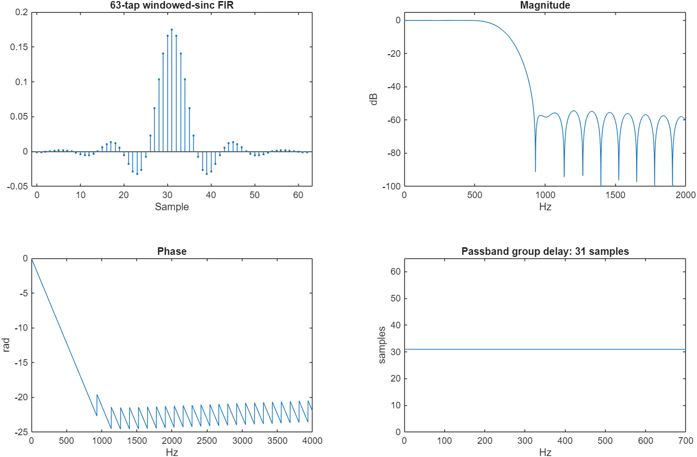

Figure 1. The 63-tap windowed-sinc demonstration illustrates causal convolution and approximately constant passband delay. Its latency is not a live ANC performance measurement.


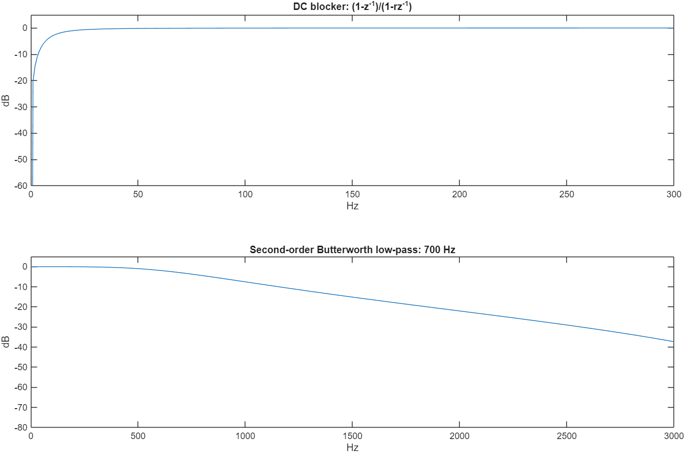

Figure 2. The zero at DC rejects offset. The biquad trades low computational cost for frequency-dependent phase.


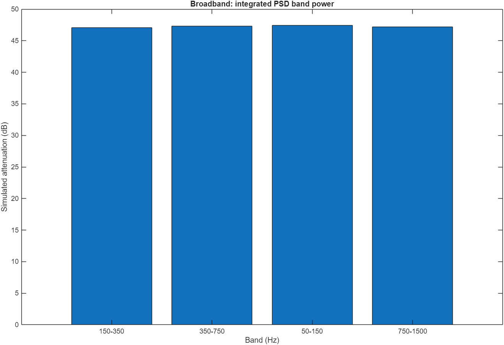

Figure 3. Integrated spectral powers describe the selected final-window bands under the fixed simulated plant.


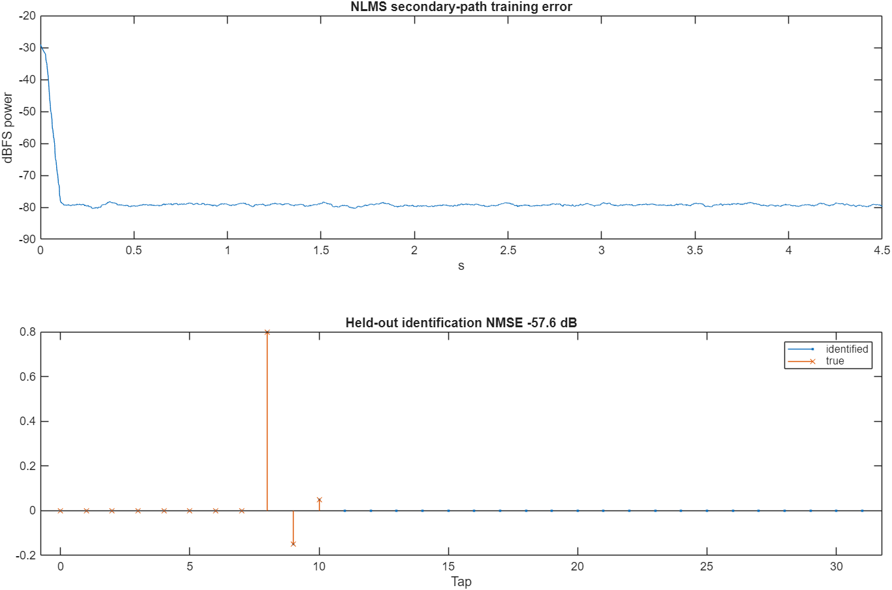

Figure 4. An independent probe trains an FIR model; held-out samples test prediction after coefficients are frozen.


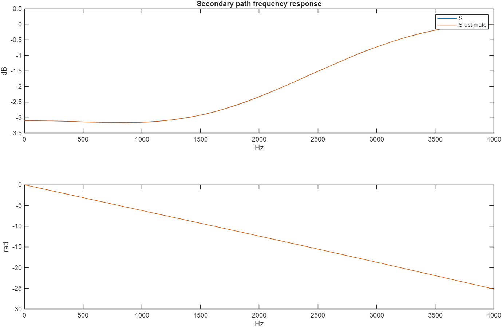

Figure 5. Magnitude alone is insufficient for control because phase errors can reverse the useful update direction.


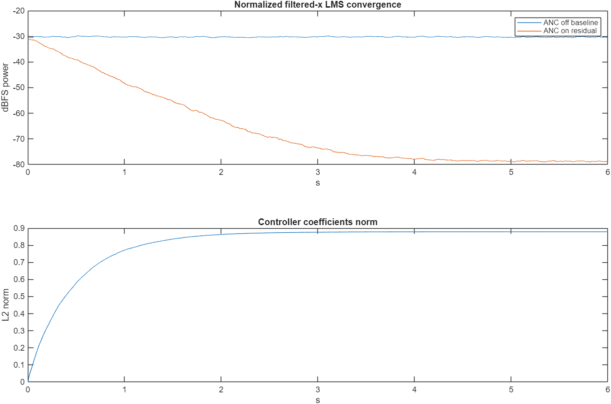

Figure 6. Error energy and coefficient norm expose startup and adaptation under the favorable model.


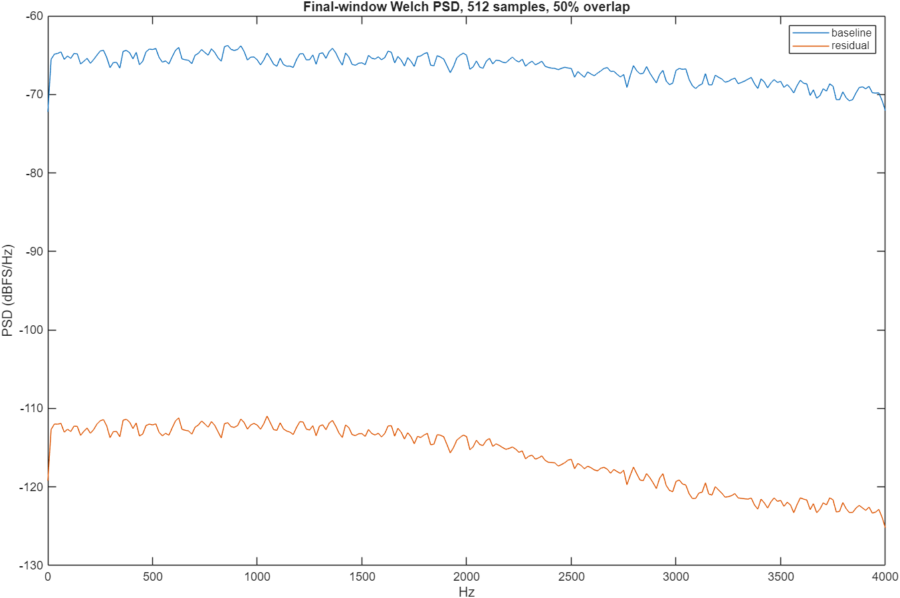

Figure 7. The plotted difference is simulated sensor reduction; no commercial headphone performance is inferred.


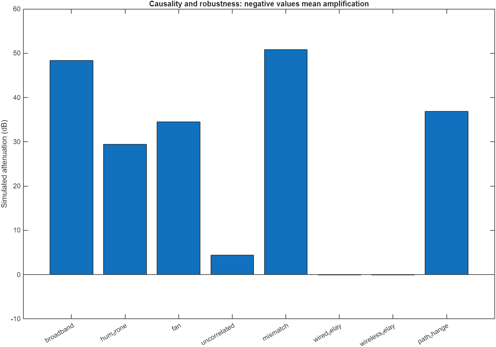

Figure 8. Increasing secondary delay beyond primary preview defeats the unpredictable broadband example.


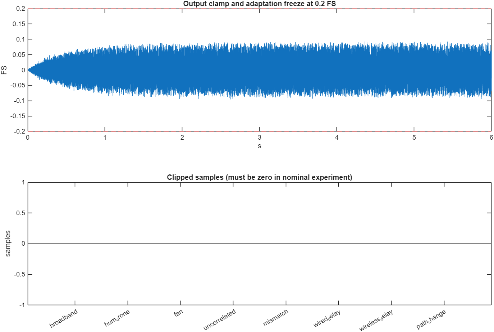

Figure 9. No nominal clipping occurred. A digital output cap does not define acoustic SPL.


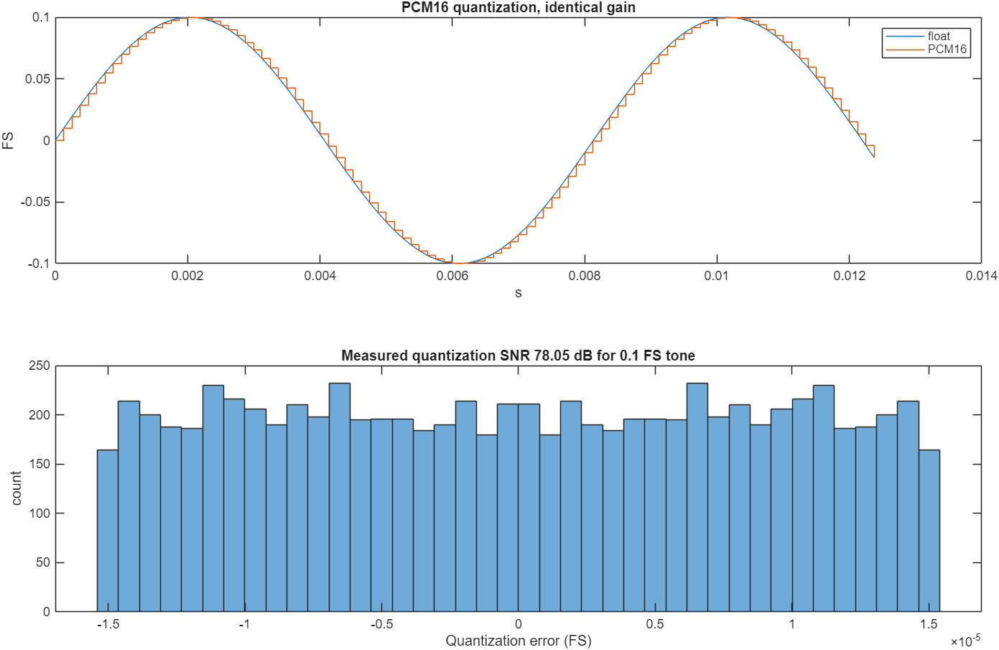

Figure 10. The quantization example uses a 0.1 FS sine and no dither. Equal gain is retained for listening comparisons.


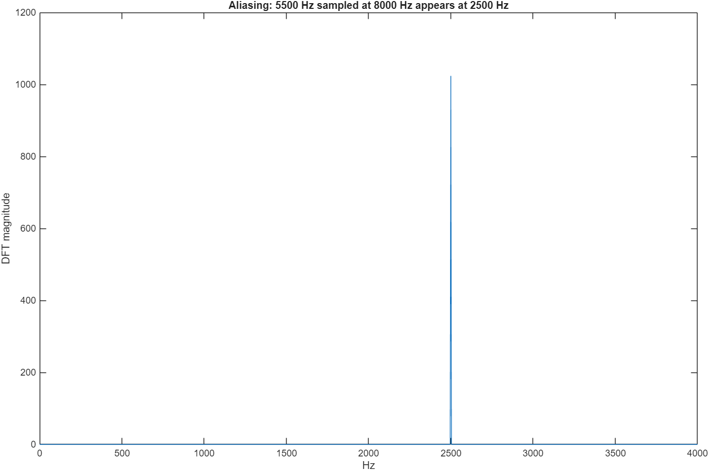

Figure 11. A 5.5 kHz tone folds to 2.5 kHz at an 8 kHz sampling rate. Digital processing after the ADC cannot undo this ambiguity.


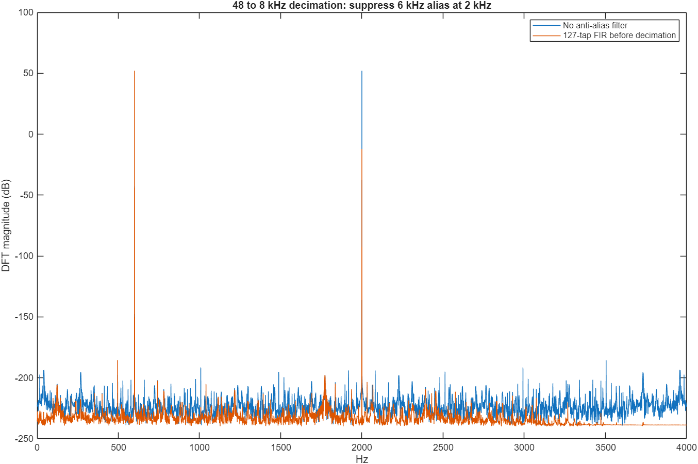

Figure 12. The 127-tap offline FIR suppresses high-frequency content before decimation by six; it adds delay.


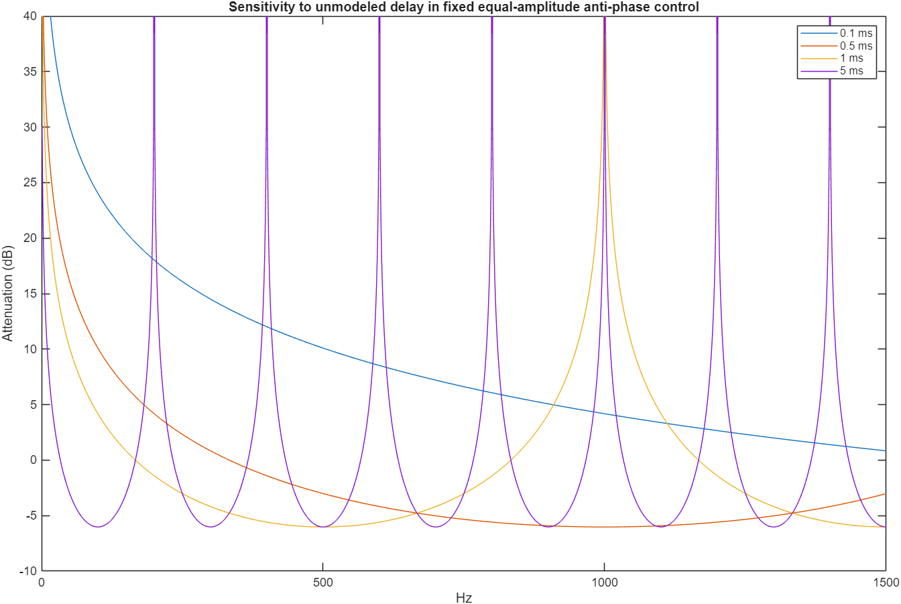

Figure 13. Small unmodeled timing changes produce increasing phase error and can turn cancellation into amplification.


### 9 4 Digital adaptive figures


Figure 14. RLS tracks quickly in this selected case. LMS and NLMS convergence depend on their different configured step sizes.


Figure 15. The leakage case must also be assessed using desired-signal gain; apparent noise removal alone is misleading.


Figure 16. The matched clean target separates interference removal from wanted-signal distortion.


Figure 17. Wanted-signal contamination of the reference causes substantial suppression of the intended output.


Figure 18. Error increases during the absent reference interval; final-window metrics show subsequent recovery.


### 9 5 Stationary tone feasibility model

The additional MATLAB feasibility test uses an illustrative 120 Hz tone and 200 ms fixed modeled delay. It is separate from the 300 Hz hardware procedure. With fixed delay, phase calibration can compensate a periodic tone; unmodeled changes after calibration degrade it.


| Timing change ms | Synthetic reduction dB |
|---|---|
| 0 | 29.036 |
| 0.1 | 21.597 |
| 0.5 | 8.492 |
| 1 | 2.655 |
| 2 | -2.726 |


These chosen delays are not measured Crystl latency or jitter. They quantify model sensitivity only.

## 10 Physical hardware demonstration and measurement

No measured hardware reduction is available at the report date. The procedure below is implemented for collecting that evidence. The test is performed with the earbud outside the ear and optimizes the microphone position only.

### 10 1 Available equipment and wiring

- Laptop with its built-in microphone and Windows software.
- Android 16 phone with the supplied app and built-in speaker.
- boAt Nirvana Crystl earbuds connected to the controller device.
- Fixed supports for the phone and left earbud; these preserve acoustic geometry.

Phone speaker -> disturbance -> laptop microphone.

Laptop control output -> left Crystl earbud -> same laptop microphone.

### 10 2 Four phase model

At one frequency, D is the disturbance phasor, H the output-to-microphone response, c the control phasor, a the small probe amplitude and F an approximately constant measurement floor. Stage power follows the following model. The equations identify a candidate, rather than proving physical cancellation.

    P(c) = |D + H c|^2 / 2 + F
    B = (mean(P_probe) - P_off) / a^2
    G = (P_0 - P_pi)/(4a) + j (P_3pi/2 - P_pi/2)/(4a)
    c_opt = -conjugate(G) / B

The implementation requires positive resolvable B, consistent phase observations, stable source power and unchanged routing. Bluetooth delay can be absorbed only while its phase contribution remains sufficiently stable. Candidate amplitude and predicted residual are validated against actual OFF ON OFF data.


### First test phone source  laptop controller

1. Extract `dist/UniversalANC-Windows.zip` to a writable folder and open `universal_anc_desktop.exe`. No Python or MATLAB is required to run this app.
2. Install `dist/UniversalANC-Lab.apk` on the Android phone. Android 16 is within the supported OS range; actual phone routing still needs to be checked. Installation is manual unless the phone is connected and authorized for development.
3. Connect both Crystl earbuds to the **laptop**, turn boAt ANC and Ambient modes OFF, and keep the earbuds active outside your ears. Disable wear-detection through the manufacturer's supported controls if needed. Do not wear the control earbud for this first bench test.
4. In the phone app, set **300 Hz** and tap **PLAY SOURCE TONE on phone speaker**. This emits a real, moderate-level tone for up to two minutes. Adjust physical source placement/volume so the laptop microphone can clearly hear it without clipping. The phone must remain in the foreground.
5. Position the **LEFT earbud** acoustic outlet next to the laptop microphone, without blocking either opening. Keep the phone and earbud fixed. A non-electronic support can help hold geometry steady. Cancellation will be measured only at this sensor point.
6. In the Windows app, select **Microphone (Realtek Audio), 48000 Hz** and **Headphones (Nirvana Crystl), 48000 Hz**. Do not select the 16 kHz Bluetooth headset microphone. The detected endpoints are preselected when their names match.
7. Press **Start 32-second test**. Do not move devices or change volume. The app shows live microphone RMS, target-tone power, phase and DSP callback time. **Stop and mute** ends output immediately through stream shutdown.
8. At the end, the app reports whether a completed test observed at least 3 dB of target-tone reduction or a rejection/failure. **Open session files** shows recordings and metadata under your Documents/UniversalANC/sessions folder. A failed calibration is not presented as successful ANC.

The Windows tonal mode requests RAW capture, matching native float sample rates, and an unchanged audio stream. If opening fails, verify OS microphone access yourself, select the laptop microphone and media headphone output, and check whether the driver supports RAW capture. The app does not bypass OS privacy permissions.


### Phone controller  laptop source

1. Connect the Crystl earbuds to the **phone**. Play the included `reference_300Hz.wav` through the **laptop's built-in speakers**, not through the earbuds. Select the speaker output in the OS/media player yourself. The WAV lasts two minutes and preserves a continuous tone.
2. In the phone app, refresh routes and select the **phone's built-in microphone** and **Nirvana Crystl media output**. Set 300 Hz. Place the LEFT earbud beside the phone's microphone and keep the source fixed. Keep the phone screen/app in the foreground.
3. Tap **START 32 s tonal cancellation test**, grant microphone permission when requested, and press START again. The app verifies actual input/output routes and stops if Android ignores or changes them.
4. A phone supporting unprocessed capture uses it. Otherwise voice-recognition capture is requested with available AGC/NS/AEC effects disabled. In that fallback the report explicitly marks microphone processing unverified; it cannot establish validated ANC attribution.
5. Use **SAVE tonal session ZIP** after the test. Copy the ZIP to the laptop and open it using the MATLAB comparison function below. Export only after recording has ended. The file picker/background transition stops any active audio operation.

Do not use simultaneous source and cancellation modes on the same phone. A device playing the independent source must not route that source into the control earbud. The source mode checks actual phone-speaker routing and rejects a mismatched route.


### What the automatic sequence does

| Time | Output state | Purpose |
|---|---|---|
| 0–4 s | OFF | Measure the target tone and baseline |
| 4–8 s | Small probe, 0 degrees | Identify interference response |
| 8–12 s | Small probe, 90 degrees | Identify interference response |
| 12–16 s | Small probe, 180 degrees | Identify interference response |
| 16–20 s | Small probe, 270 degrees | Fit and validate control amplitude/phase |
| 20–24 s | OFF | Verify source level before control |
| 24–28 s | Candidate ON | Measure the actual residual |
| 28–32 s | OFF | Check source drift after control |

Each stage excludes its first two seconds and last 0.1 s from the final measurement. Output transitions have 20 ms ramps. Probe amplitude is 0.02 FS. The candidate must remain below 0.08 FS. These are digital amplitude caps, not calibrated SPL limits.

The microphone must hear both the unwanted source and the control earbud. If the earbud is too far away, the necessary amplitude may exceed the cap; the test refuses rather than raising gain without bounds. Fixed Bluetooth delay is absorbed into a stationary phase calibration. Time-varying delay, frequency drift, movement, nonlinearities, wear-detection shutdown and capture processing can still prevent cancellation.


### Rejections and results

The controller rejects absent/weak tones, nonfinite/clipped microphone input, inconsistent phase observations, unidentifiable acoustic response, excessive required output, source level changes greater than 1 dB, and measured amplification during the candidate window. Stream errors, packet discontinuities and route changes stop output. These checks reduce confounding; they do not prove a general stable acoustic system or certify ear protection.

`session.json` records provenance, platform, selected devices, completion/fault state, candidate amplitude/phase, processing time and whether RAW capture was requested. `stages.csv` contains actual measured stage powers. `microphone.wav` and `control.wav` contain the recording and emitted digital waveform at a common software timeline. They are PCM16 at the native session rate, with unchanged relative gain. The driver/codec/acoustic latency is present in the physical recording and is not mislabeled as zero.

Target-tone values below an estimated measurement floor are reported as floor-limited, not as an exact arbitrarily deep null. Negative reduction means amplification. Callback processing time is not round-trip latency; actual round-trip latency remains null/unmeasured until independently acquired. Values are digital FS/dBFS or level differences, not calibrated dB SPL.


### MATLAB actual recording versus identified simulation

```matlab
addpath('D:/DSD/matlab');
anc_compare_tonal('C:/path/to/tonal-session-folder');
% Or pass an exported ZIP; select its extracted folder on subsequent runs.
```

The function independently recomputes target-tone and total powers from the WAV, checks completion, gain/source drift and phase consistency, reconstructs a stationary phasor model from the OFF/probe observations, and predicts the candidate's residual. It writes `comparison.csv`, `COMPARISON.md`, `comparison.mat`, and editable/PNG figures. The model uses measured conditions; it is not the old idealized 8 kHz broadband simulation presented as a prediction for your headset.

If an experiment is incomplete or conditions fail validation, the report flags it and withholds an approved attenuation claim. A measured ON/OFF level difference can still be displayed as a diagnostic, without claiming it establishes ANC. Predictions can differ from measurements because the model assumes constant phase, level, geometry and linearity. The non-target noise floor is estimated from the recording.


### 10 3 Full two sensor fixture

Use one USB audio interface with two simultaneous independent microphone/line inputs and at least one output, sharing one clock. Input 0 is a reference microphone positioned toward the noise source. Input 1 is an error microphone in a fixed ear coupler or enclosed test fixture. Output 0 drives the control headphone/driver through a gain-controlled amplifier. Use a repeatable noise loudspeaker independent of the control driver. Separate microphones and correct gain staging are essential.

Keep reference-to-error propagation preview larger than the complete output/control/measurement delay for broadband cancellation. At sound speed roughly 343 m/s, even 1 m of acoustic preview is only about 2.9 ms. Laptop/phone IO can exceed that; a near-ear low-delay embedded controller is normally needed for consumer ANC. A favorable synthetic delay is not evidence that a host setup can meet it.

Validate channel assignment with separate physical stimuli. A stereo endpoint can still expose duplicated or beamformed mono; inspect captured independent channels. Disable AGC, enhancement and echo cancellation where possible. Keep all device gains and microphone geometry fixed after calibration. Start with a coupler and conservative hardware gain; the FS limiter does not specify SPL at an ear.

Wired headphones alone supply no independent error microphone. Most Bluetooth headsets expose a communications microphone and buffered playback, while internal ANC sensor channels are private to headset firmware. The detected Nirvana Crystl route on this computer exposes 16 kHz mono capture and 48 kHz stereo output; this is insufficient for this two-sensor host ANC architecture. Use the headphone's built-in ANC for normal wireless listening.


### 10 4 Fixture calibration and hardware run


1. Build a bench fixture per `HARDWARE_SETUP.md`. Mute program audio and all OS audio effects. Fix gain, geometry, sample rate and stream configuration.
2. List Windows endpoints with `universal_anc_win --devices`. Record with:

   `universal_anc_win --record-probe recording.csv "CAPTURE_ID" "RENDER_ID" 48000 10`

   Probe amplitude is +/-0.02 FS. CSV uses output probe and the error microphone on input 1 at the software sample timeline. The full delay is represented by leading FIR zeros. The app prints the exact route token `CAPTURE_ID|RENDER_ID`.
3. Identify and validate:

   `anc_measurement recording.csv 48000 2048 "CAPTURE_ID|RENDER_ID" calibrated.profile calibration_report.csv`

   2048 taps span 42.67 ms at 48 kHz. Increase only when the captured impulse response needs it (max 4096). Training is first 75%; held-out validation last 25%. A threshold alone is not sufficient: inspect tap delay, residual and repeat recordings for clock drift. Repeatability is required because host IO delay may change between stream opens. Reject variable-delay routes; this prototype has no fractional delay tracking or automatic drift compensation.
4. Run control for a fixed interval:

   `universal_anc_win --fixture calibrated.profile "CAPTURE_ID" "RENDER_ID" 48000 10`

   Only output channel 0 is active. A discontinuity, underrun or invalid sample stops the loop. If startup immediately trips, inspect native format and stream timing; do not bypass trip checks.
5. For actual attenuation, record baseline with ANC off and then residual with ANC on under the SAME source, gain, position and fit. Compare matched error-sensor power, spectra and calibrated SPL. Reference-vs-error RMS is not attenuation. The current live app does not automatically collect a matched ANC-off/on report: acquire it independently on the bench.

The supplied `results/matlab/identified.profile` has `route=simulation` and is intentionally unusable for live output. The old recovered JSON profile was an example, not proof of a measured headset calibration; it is archived under `recovery/recovered_examples/`.

Profile text format:

```
ANC_PROFILE_V1 48000 ROUTE_TOKEN NUMBER_OF_TAPS
tap_0
tap_1
...
```

Route tokens contain no whitespace. The calibration application stores sample rate and endpoint identity; changing any gain or acoustic fit requires recalibration even if IDs remain the same.


### 10 5 Repeatability and uncertainty

Use at least three complete sessions with unchanged source, fit, position and gains before making a repeatability statement. This is a proposed reporting protocol; it has not been executed. Record each outcome, including rejections, rather than selecting only the best run. Report mean, standard deviation, minimum and maximum accepted reduction, plus the number of invalid trials and their causes. Do not average rejected sessions into an approved attenuation value.

Microphone enhancement, quantization, tone-frequency drift, Bluetooth phase variation, room reflections and source changes contribute uncertainty. The OFF measurements bracket the ON stage to detect drift. Values below an estimated measurement floor should be stated as floor-limited. Without microphone sensitivity calibration and a pressure reference, report relative reduction and dBFS, not dB SPL.

Actual latency needs a separately synchronized loopback or acoustic measurement with a known timing reference. Correlation must resolve transport ambiguity and include the complete route. Callback duration and a periodic tone's phase cannot uniquely recover an unknown multi-cycle transport delay.

## 11 Verification and reproducibility


Executed on Windows, 29 October 2026. Results below describe software and synthetic signals. Physical phone execution and ear-level attenuation with boAt Nirvana Crystl remain unmeasured.

| Check | Result |
|---|---|
| Release C++17 Windows build | Passed: desktop GUI, CLI, simulator, adaptive processor and calibration tool |
| CTest algorithm and safety suite | Passed: filters, calibration, LMS/NLMS/RLS, FxNLMS, tonal model, reference/fault/watchdog guards |
| CTest processing allocation instrumentation | Passed: zero counted new/new[] allocations during tested DSP blocks |
| Independent MATLAB R2025b implementation | All 15 algorithm/scenario cases passed; largest residual difference from C++ 2.24e-5 FS |
| Kotlin DSP comparison | All 15 C++ traces matched within 2.24e-5 FS; convergence, delay, silence and nonfinite tests passed |
| Offline CSV processing | LMS/NLMS/RLS processed 8000 samples each; tail residual RMS below 0.001 FS for a correlated-noise fixture |
| Invalid offline inputs | Bad headers, nonfinite/empty data and input/output file identity rejected; original input preserved |
| Calibration CLI | Known delayed FIR identified at delay 3; held-out NMSE approximately -125 dB on the synthetic fixture |
| Calibration validation | Invalid rate/taps/route, clipped and nonfinite samples rejected |
| Existing eight acoustic simulations | Completed; low-delay model converged, modeled broadband transport delay did not provide cancellation |
| Windows CLI smoke test | Silent --demo completed; no physical output or attenuation claim |
| Android assembleDebug | Passed; installable debug APK generated, version 2.2, min API 26, target API 35 |
| Android lintDebug | Passed: 0 errors, 28 warnings, primarily localization and legacy backup configuration |

Reproduce with `scripts/run_full_dsp.ps1`, `scripts/build_android.ps1`, and `scripts/test_android_dsp.ps1`. Run Android lint with `apps/android/gradlew.bat -p apps/android lintDebug`. Build prerequisites are in the platform build documentation. APK/ZIP hashes are in `dist/checksums.json`.

The generic Android LMS/NLMS/RLS module is a reusable digital processing library. The app's existing live modes remain the calibrated FxNLMS fixture and experimental single-tone test. An arbitrary headset does not expose the independent synchronized reference/error signals needed to validate general acoustic ANC. Use `docs/LIVE_TONAL_DEMO.md` for the available physical experiment and `anc_compare_tonal` for exported recordings; those recordings are required before reporting measured improvement.


### 11 1 Evidence separation

The core tests use known synthetic plants and deliberate fault inputs. MATLAB independently recomputes arithmetic, and the JVM runs Kotlin algorithms without phone audio hardware. The synthetic tonal session under results/tonal_pipeline_test validates export and analysis; it is not a physical recording. The analyzer refuses synthetic provenance by default. Changing a provenance label cannot convert synthetic data into physical evidence.

Each physical result should retain its session JSON, stage CSV, raw microphone WAV, control WAV and analyzer outputs together. Record software version, selected devices, source frequency, geometry, gains and built-in ANC state. Preserve relative gains between baseline and residual audio. Physical recordings are excluded from the public source snapshot by default.

### 11 2 Software reproducibility

Windows requires CMake 3.20 or later, Ninja and a C++17 compiler. MATLAB R2025b was used with custom base functions and no DSP toolbox dependency. Android uses JDK 17, SDK platform 35, Gradle 8.7, AGP 8.5.0 and Kotlin 1.9.22. Android minimum API is 26 and target API is 35; Android 16 hardware behavior is still untested. The standard Android build does not require the NDK.

The clean GitHub baseline is the commit stated on the cover. The original workspace contained corrupt Git metadata and files, preserved in a local recovery archive; it must not be confused with the clean published checkout. Artifact sizes and SHA256 hashes are in dist/checksums.json. The APK is a debug research build, not an app-store release.

## 12 Limitations and future development

### 12 1 Present limitations

- Universal broadband acoustic ANC through arbitrary wired or wireless headphones is unachieved.
- No Crystl microphone-point or ear-canal attenuation, calibrated SPL, or real round-trip latency has been measured.
- No physical Android 16 execution has been completed; API support and build success do not prove routing or acoustic behavior.
- The general Android digital algorithms are reusable modules, not a universal ANC toggle in the UI.
- Independent references, observable error sensing and sufficient preview are not supplied by an ordinary playback endpoint.
- The two-sensor fixture needs additional synchronized hardware; matched OFF ON reporting is not automatic in that mode.
- Models omit important real effects including acoustic feedback, complex fit changes, clock drift and time-varying transport.
- RLS uses conventional covariance recursion and a protective norm projection, not QR or square-root RLS; difficult long-duration numerical conditioning needs further study.
- Processing allocation tests do not prove deadline scheduling, complete process allocation behavior, or safe acoustic output.
- Desired-signal leakage can remove wanted audio. No speech-intelligibility or perceptual study is included.
- iOS, macOS and Linux audio backends are not implemented; portable core code does not imply those product integrations exist.
- Android lint has 28 nonfatal warnings. The shipped application remains a research prototype.

### 12 2 Development sequence

First collect repeatable physical single-tone sessions and compare measured ON power with the identified model. Then validate Android preferred versus actual routes, permission denial, background stop and disconnect muting on the specific phone. Build a synchronized acoustic fixture and measure full transport delay, channel independence and calibration repeatability before broadband control. Evaluate more adverse plants, speech leakage, longer recordings and acoustic feedback. Consider local embedded processing with accessible near-ear microphones for genuine low-latency headphone operation. Each stage needs its own measured acceptance evidence; a successful stationary tone is not the final universal product.

## 13 Conclusion

The project delivers custom adaptive digital cancellation, acoustic filtered-x control, calibration, protective processing, Windows and Android research software, and reproducible MATLAB evidence. Twenty-three numerical cases demonstrate learning, tracking, causality failure, uncorrelated-noise limits, reference dropout and wanted-signal loss. Cross-implementation comparisons support consistency of the implemented DSP.

The physical demonstration is ready to attempt with a fixed microphone and ordinary earbud, but its result is not yet known. Universal low-latency cancellation at a listener's ear remains outside the verified outcome. The next defensible milestone is an actual exported session with repeatable measured reduction and a valid simulation comparison.

## Appendix A Notation and terminology


| Symbol or term | Meaning |
|---|---|
| x or r | Reference input; r may denote conditioned acoustic reference |
| d | Primary input or uncontrolled acoustic disturbance depending on architecture |
| e | Digital residual or physical error sensor sample |
| w W | Adaptive FIR coefficients and corresponding filter |
| P | Primary acoustic path; in RLS equations P is inverse covariance instead |
| S Shat | Actual and estimated secondary acoustic path |
| L M | Controller tap count and secondary model tap count |
| mu lambda epsilon | Learning step forgetting factor and regularization |
| FS dBFS | Normalized digital full scale and level relative to it |
| SNR NMSE PSD | Signal to noise ratio normalized mean square error and power spectral density |
| ANC | Active acoustic control or adaptive cancellation; architecture stated explicitly |
| SPL | Sound pressure level requiring calibrated pressure units |


## Appendix B Source and artifact inventory


| Location | Purpose |
|---|---|
| core/include/anc | FIR DC biquad adaptive LMS NLMS RLS FxNLMS engine guards calibration profiles metrics tonal controller |
| core/tests | Algorithm convergence filtering blocks calibration safety and allocation tests |
| apps/windows | WASAPI backend desktop GUI and command line fixture tools |
| apps/android | Kotlin application DSP audio engines route checks source and session export |
| tools/simulator | Acoustic simulator digital adaptive benchmark and synthetic tonal pipeline test |
| tools/measurement | Secondary path calibration executable |
| matlab | Acoustic visualizer fundamentals adaptive algorithms tonal feasibility and session analyzer |
| results/matlab | 13 acoustic and fundamentals figures traces tables workspace and WAV files |
| results/full_dsp | 15 digital traces 5 figures metrics evidence MAT and equal-gain WAVs |
| results/tonal_feasibility | Illustrative stationary tone timing model |
| results/tonal_pipeline_test | Explicitly synthetic session fixture |
| scripts | Build test simulation packaging report and phone installer utilities |
| dist | Android APK Windows ZIP source WAV and checksums |
| docs | Architecture hardware calibration usage feasibility limitations and validation |
| recovery | Local preserved original evidence excluded from publication |


## Appendix C Physical results worksheet

This is a measurement worksheet, not an executed result. Fill entries from actual session files and keep failed trials visible.


| Field | Current value |
|---|---|
| Phone model and OS build | Not measured |
| Session identifier and timestamp | Not measured |
| Controller platform and exact routes | Not measured |
| Microphone and earbud positions | Not measured |
| Source frequency and fixed gain settings | Not measured |
| Manufacturer ANC state | Not measured |
| ANC off target power and dBFS | Not measured |
| ANC on target power and dBFS | Not measured |
| Validated reduction and floor flag | Not measured |
| Predicted reduction from measured model | Not measured |
| Measured minus predicted difference | Not measured |
| Callback duration and route faults | Not measured |
| Independently measured round trip latency | Not measured |
| Repeat count mean spread and rejected trials | Not measured |


Record source geometry and route settings before each run. After analysis, copy numerical values from comparison.csv and the validation outcome from COMPARISON.md. If a field has not been acquired, retain Not measured rather than substituting a synthetic number.

## Appendix D Build and command reference

Run these commands in PowerShell from D:\DSD. Build tools, MATLAB, JDK and Android SDK must already be available as described in Chapter 11.

```powershell
.\scripts\build_windows.ps1
.\scripts\run_tests.ps1
.\scripts\run_project.ps1
.\scripts\run_full_dsp.ps1
.\scripts\build_android.ps1
.\scripts\test_android_dsp.ps1
.\apps\android\gradlew.bat -p apps/android lintDebug
```

Standalone MATLAB entry points

```matlab
addpath('D:/DSD/matlab');
anc_dsp_visualizer;
anc_full_dsp;
anc_tonal_feasibility;
anc_compare_tonal('C:/path/to/actual/session');
```

Generate C++ traces before the MATLAB comparison. Offline digital CSV processing assumes synchronized 8 kHz normalized inputs with header reference,primary. Its output header is estimate,residual and it does not report SNR without a clean target.

```text
anc_adaptive --benchmark results/full_dsp/cpp
anc_adaptive --process input.csv nlms output.csv
universal_anc_win --devices
universal_anc_win --demo
```

The demo command is silent synthetic processing. Use the Windows GUI for the separate 32-second tonal test. After collecting an actual session, run

```powershell
.\scripts\run_tonal_comparison.ps1 -SessionPath "C:\path\to\session"
```

## References

[1] MathWorks. Active Noise Control Using a Filtered X LMS FIR Adaptive Filter. https://www.mathworks.com/help/audio/ug/active-noise-control-using-a-filtered-x-lms-fir-adaptive-filter.html

[2] MathWorks. Signal Enhancement Using LMS and NLMS Algorithms. https://www.mathworks.com/help/dsp/ug/enhance-a-signal-using-lms-and-normalized-lms-algorithms.html

[3] MathWorks. dsp RLSFilter documentation. https://www.mathworks.com/help/dsp/ref/dsp.rlsfilter-system-object.html

[4] Android Developers. Audio latency. https://developer.android.com/ndk/guides/audio/audio-latency

[5] ANC DSP project source and executed evidence. https://github.com/troon07/ANC-DSP/tree/ed65e136697664b49c131bc6d04a65bba660bb56

External references accessed 29 October 2026. Equations, parameters and results in this report describe the custom implementation and its local experiment artifacts. External examples provide engineering context; their results are not claimed as this project's measurements.
