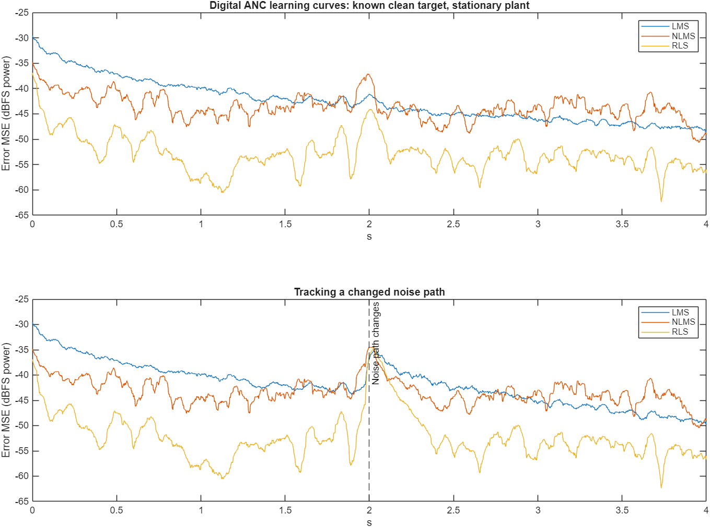
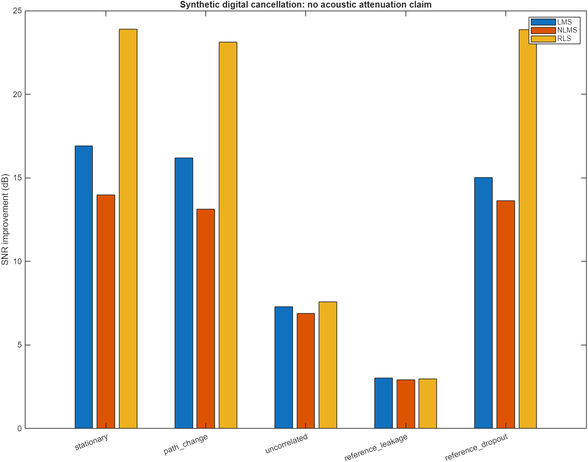
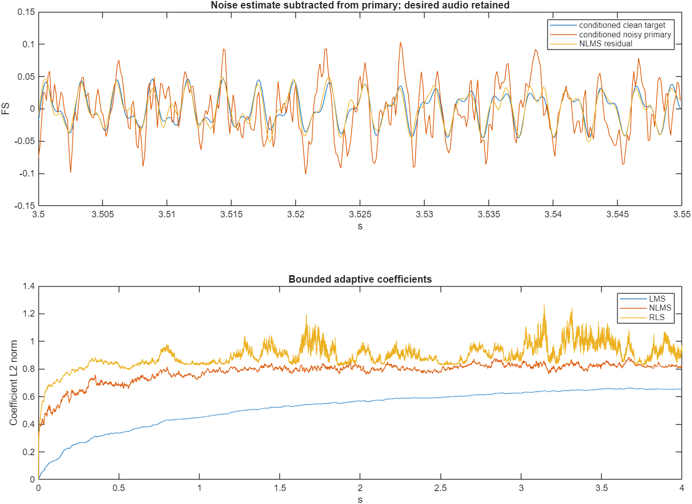
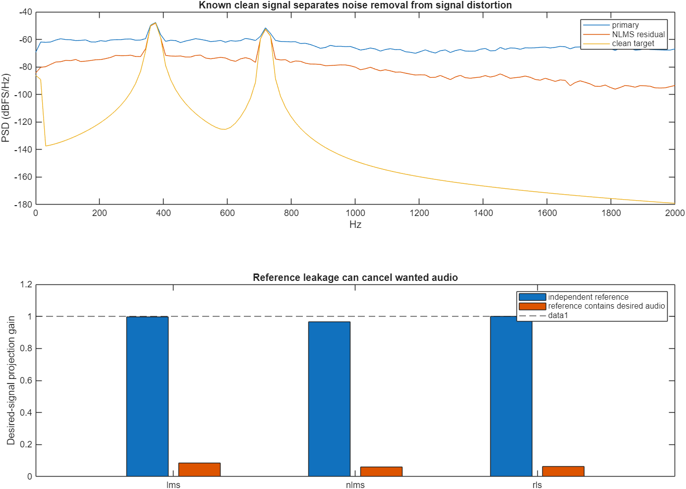
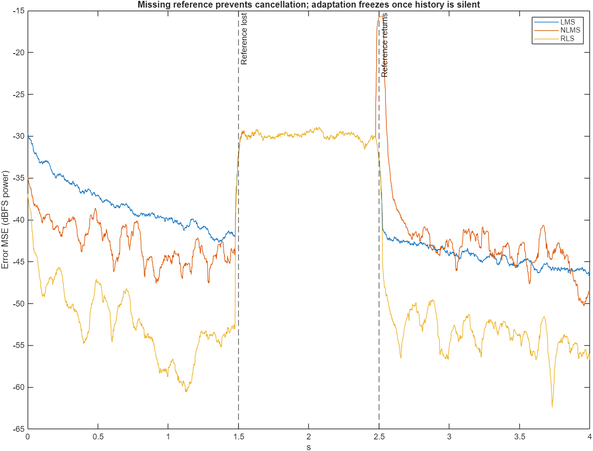

# Full adaptive DSP implementation: executed results

Digital reference-based noise cancellation. All signals in this experiment are synthetic; SNR uses the known conditioned clean target. These values are not acoustic headphone attenuation.

C++17 and independent base-MATLAB implementations: 8 kHz, 4 seconds per case, 16 taps; DC cutoff 10 Hz and second-order low-pass 1500 Hz. LMS step 0.1; NLMS step 0.05; RLS forgetting factor 0.999, initial inverse covariance 10I. Values below use the last second. Algorithm ranking depends on these parameters and inputs.

| Scenario | Algorithm | Input SNR dB | Output SNR dB | Improvement dB | Desired gain | C++/MATLAB max delta FS |
|---|---|---:|---:|---:|---:|---:|
| stationary | LMS | -2.438 | 14.465 | 16.903 | 0.999 | 2.01e-07 |
| stationary | NLMS | -2.438 | 11.529 | 13.967 | 0.968 | 1.47e-07 |
| stationary | RLS | -2.438 | 21.457 | 23.895 | 1.000 | 2.09e-07 |
| path_change | LMS | -1.667 | 14.533 | 16.200 | 0.995 | 1.64e-07 |
| path_change | NLMS | -1.667 | 11.466 | 13.133 | 0.967 | 1.3e-07 |
| path_change | RLS | -1.667 | 21.456 | 23.123 | 1.000 | 1.59e-07 |
| uncorrelated | LMS | -3.159 | 4.133 | 7.292 | 0.989 | 2.21e-07 |
| uncorrelated | NLMS | -3.159 | 3.739 | 6.898 | 0.959 | 1.53e-07 |
| uncorrelated | RLS | -3.159 | 4.418 | 7.577 | 0.991 | 1.85e-07 |
| reference_leakage | LMS | -2.438 | 0.591 | 3.029 | 0.085 | 2.4e-07 |
| reference_leakage | NLMS | -2.438 | 0.493 | 2.931 | 0.059 | 1.61e-07 |
| reference_leakage | RLS | -2.438 | 0.540 | 2.978 | 0.063 | 2.18e-07 |
| reference_dropout | LMS | -2.438 | 12.576 | 15.014 | 0.999 | 2.18e-07 |
| reference_dropout | NLMS | -2.438 | 11.188 | 13.626 | 0.968 | 2.24e-05 |
| reference_dropout | RLS | -2.438 | 21.435 | 23.873 | 1.000 | 1.97e-07 |

The reference-leakage case demonstrates loss of desired audio. An uncorrelated disturbance cannot be predicted from this reference. The final-window metric does not show the dropout interval, so its full time trace is plotted separately. No speech intelligibility score or measured microphone SNR is inferred.

See docs/FULL_ADAPTIVE_DSP.md for equations, C++ APIs, guards, calibration and acoustic/digital distinctions. C++ CSV traces are under ../cpp/. Source is matlab/anc_full_dsp.m. Playback WAVs use identical gain. Actual headphone measurements remain separate.
