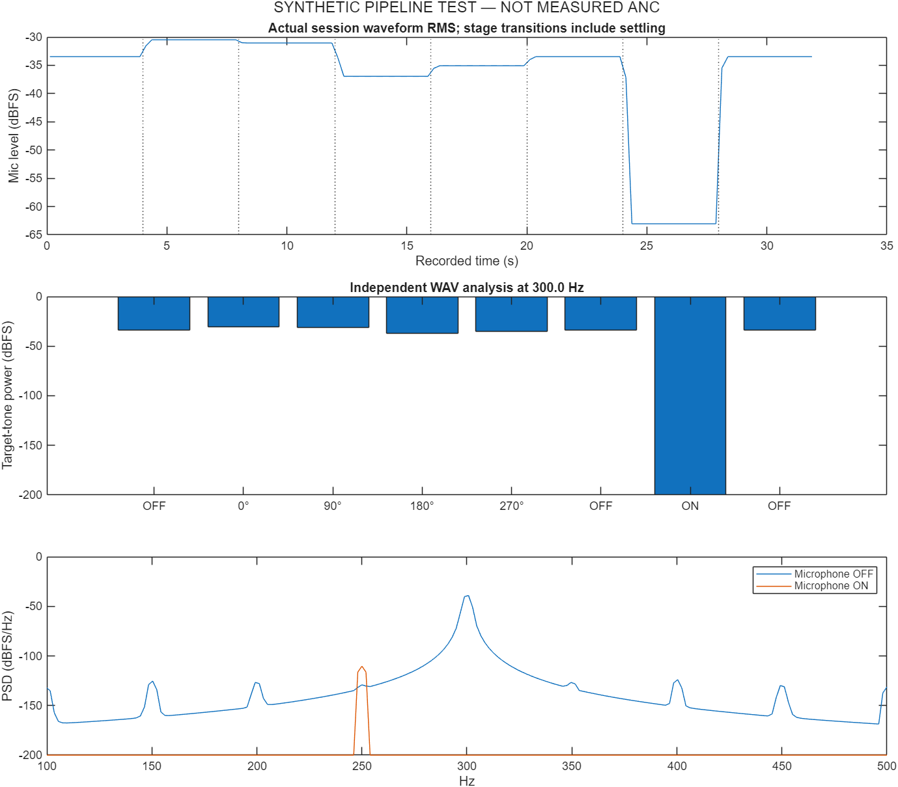

# Tonal experiment: model versus recording

**SYNTHETIC PIPELINE TEST. No physical cancellation was measured.**

Input: synthetic plant. Output: synthetic control. Target: 300.0 Hz.

Completed: 1. Independent measurement checks pass: 1. Fault: none.

| Metric | Observed recording | Identified stationary model |
|---|---:|---:|
| Target-tone level difference, dB | 68.390 | 37.864 |
| Total-power level difference, dB | 29.587 | 28.973 |

Target tone below estimated measurement floor: 1. When true, the observed tone reduction is floor-limited rather than an exact null measurement.

OFF-source drift: 0.000 dB. Calibration inconsistency: 0.00000.

The model is identified from the recorded OFF/probe stages and evaluated at the emitted control amplitude/phase. Its noise floor uses the measured non-target power. It is not an independent idealized headset benchmark. A deep predicted tone null is especially sensitive to model error, microphone noise and changing phase.

Positive observed values mean lower recorded power in ON windows. Source drift, gain changes and unverified processing can confound attribution. Passing these checks is not certification. This test concerns a fixed microphone point; it does not demonstrate ANC at a listener's ear or universal compatibility. All values are normalized digital levels, not calibrated dB SPL.

Max processing callback: 0.000 microseconds. Actual round-trip latency: **not measured**.

